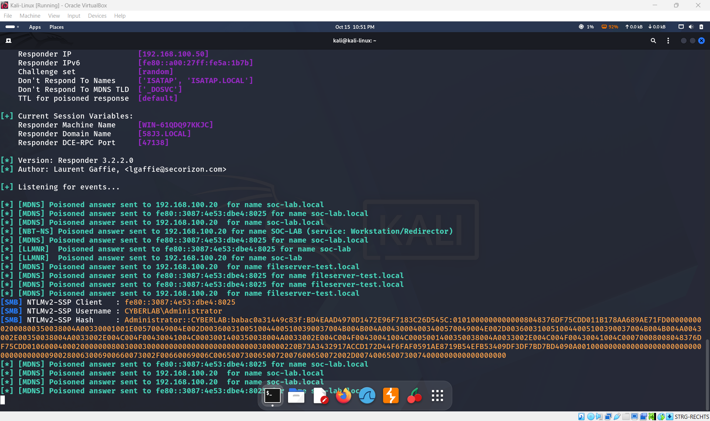
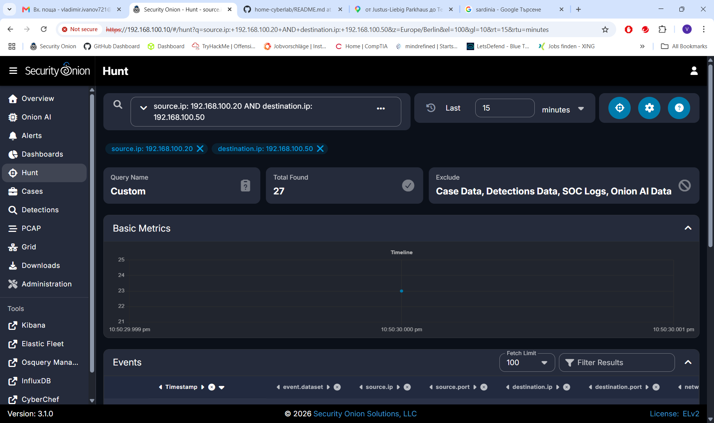
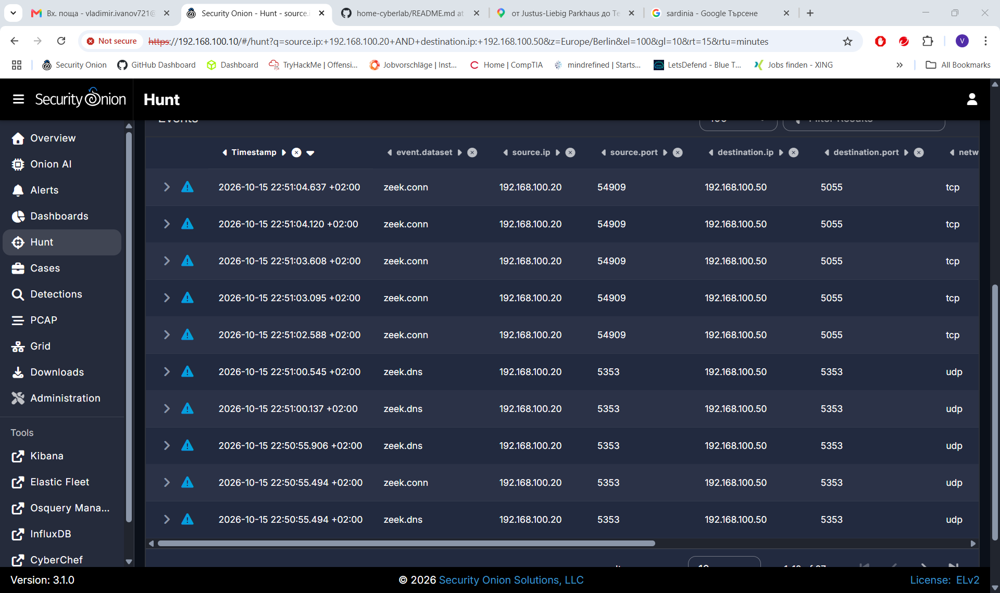
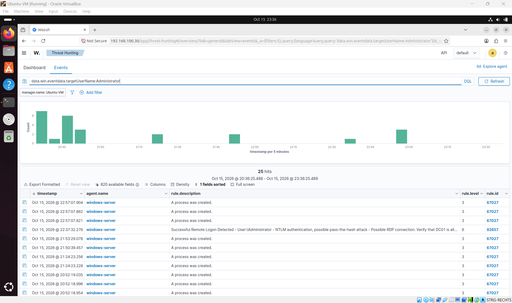
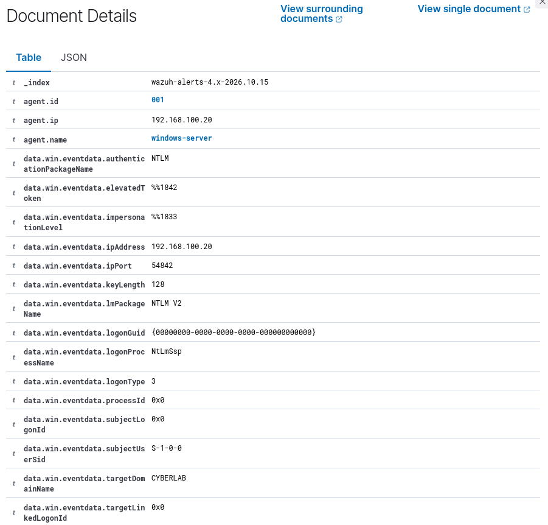
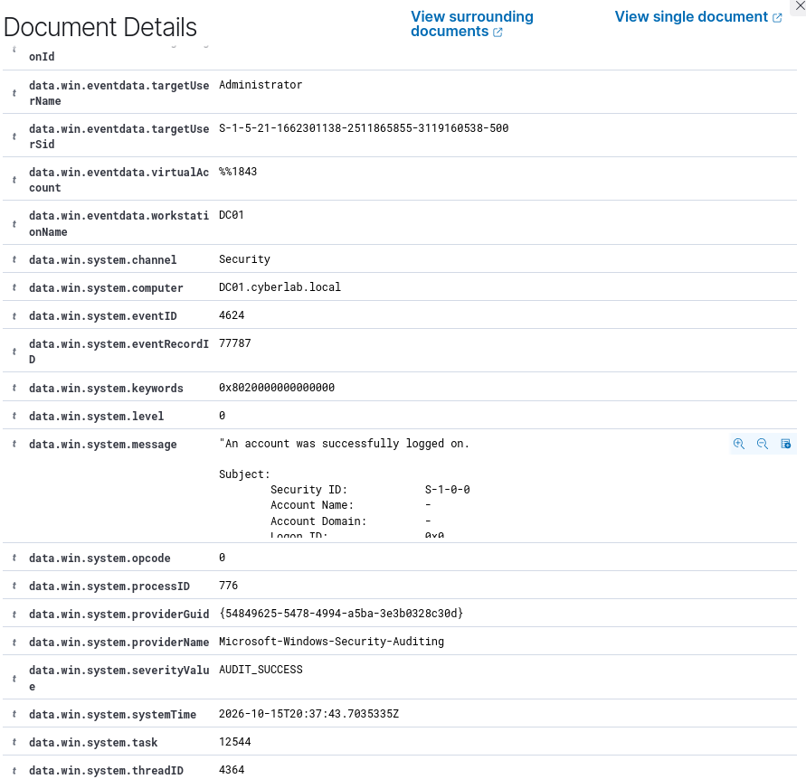
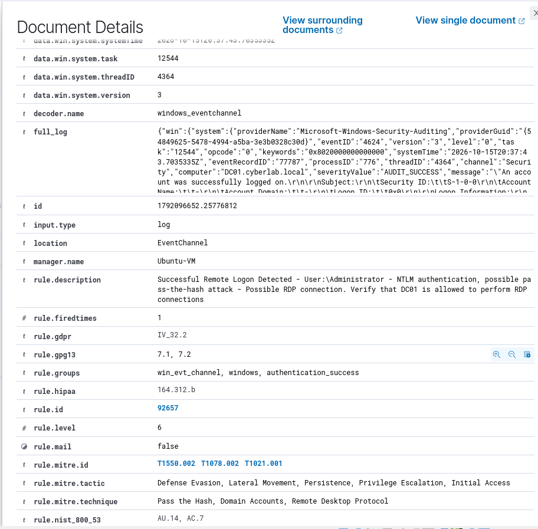
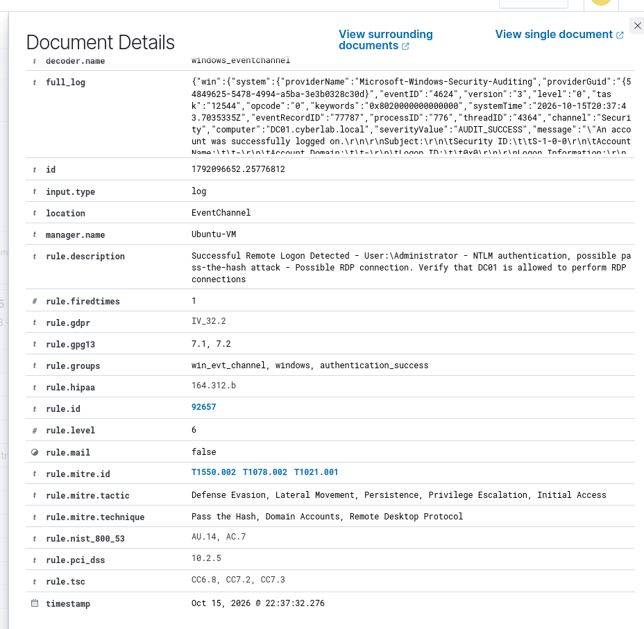

# Übung 1 – Credential Harvesting mit Responder und Auswertung in Security Onion und Wazuh

**Home Cyberlab · Dokumentationsstand: 15.10.2026 · Ersatzfassung ausschließlich für Übung 1**

Dieses eigenständige Paket ist zum Ersetzen der bisherigen Übung-1-Dokumentation vorgesehen. Bestehende Projektdateien und andere Übungen wurden nicht verändert. Es dokumentiert vorhandene Beobachtungen; es wurden keine neuen Labortests ausgeführt.

**Belegstand:** Acht tatsächlich vorhandene Screenshots sind eingebunden: Responder, zwei Security-Onion-Hunt-Ansichten, die Wazuh-Übersicht und die vier zuletzt angeforderten Wazuh-Detailbilder. Die Bildbelege sind vollständig aufgenommen. Die eindeutige technische Korrelation der Beobachtungen bleibt begrenzt und wird in Abschnitt 6 erläutert.

## 1. Ziel und Laborbezug

Ziel ist, die Erfassung einer NTLMv2-Authentifizierungsantwort durch Responder mit Netzwerkbeobachtungen in Security Onion und Windows-Anmeldeereignissen in Wazuh abzugleichen. Dabei sind Credential-Erfassung, Netzwerkverkehr und erfolgreiche Windows-Anmeldung getrennt zu bewerten.

| System | Adresse | Rolle und Belegstand |
| --- | --- | --- |
| Windows Server / DC01 | `192.168.100.20` | Wazuh-Agent `001`, Name `windows-server`; Computer `DC01.cyberlab.local` in den Detailbildern |
| Kali / Responder | `192.168.100.50` | Im Responder-Screenshot ausdrücklich als `Responder IP` sichtbar |
| Wazuh | `192.168.100.30` | Dashboard-Adresse in der Übersicht; Managername `Ubuntu-VM` in den Details |
| Security Onion | `192.168.100.10` | Adresse der Hunt-Weboberfläche im Screenshot; daraus wird keine zusätzliche Sensor-Schnittstellenadresse abgeleitet |

## 2. Responder auf Kali

Der Screenshot zeigt Responder **3.2.2.0** auf Kali mit `Responder IP: 192.168.100.50`. Im SMB-Ausgabeblock erscheinen **`NTLMv2-SSP Username: CYBERLAB\Administrator`** und eine ausgefüllte Zeile **`NTLMv2-SSP Hash`**. Damit ist die Erfassung einer NTLMv2-Challenge-Response im Screenshot belegt. Der umgangssprachlich als „Hash“ bezeichnete Capture ist weder das Klartextkennwort noch unmittelbar der gespeicherte NT-Passworthash.

*Beleg 6: Originaldatei `Екранна снимка 2026-10-15 225121.png`.*

Responder protokolliert gesendete Poisoning-Antworten für **mDNS, NBT-NS und LLMNR**, darunter an `192.168.100.20`. Sichtbare angefragte Namen sind `soc-lab.local`, `SOC-LAB`, `soc-lab` und `fileserver-test.local`. Die Ausgaben belegen die vom Werkzeug gemeldeten Antworten; die genaue auslösende Benutzeraktion ist nicht sichtbar.

Der Client des SMB-Captures wird ausdrücklich als IPv6-Link-Local-Adresse **`fe80::3087:4e53:dbe4:8025`** angezeigt. Eine unabhängige Zuordnung dieser IPv6-Adresse zum Windows-Host `.20` liegt nicht vor. Die IPv4-Poisoning-Ausgaben und der IPv6-Capture werden deshalb nicht ohne Vorbehalt als dieselbe Verbindung bezeichnet.

**Der Hash beziehungsweise die NTLMv2-Response ist nur in Responder und nicht in Wazuh sichtbar.** Dies bezieht sich auf die hier eingebundenen Belege. Der vollständige Wert bleibt im Originalbild; er wird nicht zusätzlich als Text abgeschrieben.

Der Capture belegt keine erfolgreiche Kennwortwiederherstellung, keinen erfolgreichen Relay-Angriff und keinen erfolgreichen Pass-the-Hash-Angriff. Startbefehl und genauer Capture-Zeitpunkt sind nicht sichtbar. Die Kali-Uhr oben zeigt `Oct 15 10:51 PM`; eine Zeitzone und Zeitstempel pro Ausgabezeile fehlen.

## 3. Security Onion – Hunt und Zeek

Die Hunt-Suche lautet **`source.ip: 192.168.100.20 AND destination.ip: 192.168.100.50`**. Das relative Suchfenster ist **Last 15 minutes**, und die Übersicht zeigt **Total Found: 27**. Die URL enthält `tz=Europe/Berlin`. Die Trefferzahl bezeichnet Suchtreffer und keine Anzahl bestätigter Angriffe oder unabhängiger Verbindungen.

*Beleg 7: Originaldatei `Екранна снимка 2026-10-15 225303.png`.*

*Beleg 8: Originaldatei `Екранна снимка 2026-10-15 225318.png`.*

Der sichtbare Tabellenausschnitt belegt Netzwerkverkehr **Windows Server → Kali**:

| Dataset | Sichtbare Zeiten am 15.10.2026, jeweils `+02:00` | Quelle → Ziel | Transport |
| --- | --- | --- | --- |
| `zeek.conn` | `22:51:02.588` bis `22:51:04.637` (fünf sichtbare Zeilen) | `192.168.100.20:54909` → `192.168.100.50:5055` | TCP |
| `zeek.dns` | `22:50:55.494`, `22:50:55.906`, `22:51:00.137`, `22:51:00.545` | `192.168.100.20:5353` → `192.168.100.50:5353` | UDP |
| `zeek.conn` | `22:50:55.494` | `192.168.100.20:5353` → `192.168.100.50:5353` | UDP |

Die UDP-5353-Einträge passen zu den mDNS-Ausgaben von Responder. Ein Zeek-DNS-Dataset allein bestätigt jedoch keine Manipulation. Die TCP-Zielportnummer **5055** wird so übernommen, wie sie sichtbar ist; sie wird nicht als SMB-Port 445 umgedeutet. Dienst, Verbindungsstatus und Nutzdaten dieser TCP-Einträge sind im Ausschnitt nicht ausgewiesen. Ein spezifischer Suricata-Alert ist in diesen Bildern nicht belegt; auch die Dreieckssymbole der Tabelle reichen hierfür nicht aus.

Die Netzwerkbeobachtungen liegen zeitlich nahe zur sichtbaren Kali-Uhr. Für die Zuordnung eines konkreten Zeek-Eintrags zur erfassten NTLMv2-Response fehlen jedoch passende Detailfelder beziehungsweise Paketdaten und der genaue Capture-Zeitpunkt.

## 4. Wazuh – Auswahl des untersuchten Ereignisses

Die vorhandene Übersicht zeigt die Suche `data.win.eventdata.targetUserName:Administrator` und den Filter `manager.name: Ubuntu-VM`. Das angezeigte Zeitfenster reicht am 15.10.2026 von `20:36:25.488` bis `23:36:25.489`; es werden **25 Treffer** angezeigt. Diese Trefferzahl ist keine Anzahl bestätigter Angriffe.

Das relevante Ereignis steht **an vierter Stelle von oben**: Anzeigezeit `Oct 15, 2026 @ 22:37:32.276`, Agent `windows-server`, Regel `92657`, Level `6`. Die drei darüberstehenden Zeilen tragen Regel `67027` und die Beschreibung einer Prozesserstellung; sie werden nicht als das untersuchte Anmeldeereignis verwendet. Die Position gilt für diese konkrete Bildschirmansicht.

*Beleg 1: Originaldatei `image(20261015-213719).png`.*

## 5. Wazuh – die vier neuesten Detail-Screenshots

### 5.1 Agent, NTLM-Version und Netzwerkadresse

*Beleg 2: Originaldatei `image(20261015-214055).png`.*

Sichtbare Felder:

| Feld | Wert |
| --- | --- |
| `agent.id` / `agent.name` | `001` / `windows-server` |
| `agent.ip` | `192.168.100.20` |
| `data.win.eventdata.authenticationPackageName` | `NTLM` |
| `data.win.eventdata.lmPackageName` | `NTLM V2` |
| `data.win.eventdata.logonProcessName` | `NtLmSsp` |
| `data.win.eventdata.logonType` | `3` |
| `data.win.eventdata.ipAddress` | `192.168.100.20` |
| `data.win.eventdata.ipPort` | `54842` |
| `data.win.eventdata.keyLength` | `128` |
| `data.win.eventdata.targetDomainName` | `CYBERLAB` |

Die Agent-IP bezeichnet den überwachten Host; `data.win.eventdata.ipAddress` ist dagegen die im Windows-Ereignis protokollierte Quelladresse. Beide Felder enthalten hier denselben Wert. Das Feld `keyLength` enthält eine Längenangabe und keinen Hashwert.

### 5.2 Konto, Event-ID und Windows-Zeit

*Beleg 3: Originaldatei `image(20261015-214120).png`.*

Zu sehen sind `targetUserName: Administrator`, `workstationName: DC01`, `computer: DC01.cyberlab.local`, Kanal `Security`, Event-ID **`4624`**, EventRecordID **`77787`** und `severityValue: AUDIT_SUCCESS`. Zusammen mit dem Domänenfeld aus Beleg 2 ergibt sich das Konto `CYBERLAB\Administrator`. Das Windows-Feld `systemTime` lautet `2026-10-15T20:37:43.7035335Z`.

Event 4624 beschreibt eine erfolgreiche Anmeldung; LogonType 3 steht für eine Netzwerkanmeldung. Damit ist weder eine interaktive Anmeldung noch eine RDP-Sitzung nachgewiesen. Diese Feldbedeutungen sind in der [Microsoft-Dokumentation zu Event 4624](https://learn.microsoft.com/en-us/previous-versions/windows/it-pro/windows-10/security/threat-protection/auditing/event-4624) beschrieben.

### 5.3 Wazuh-Regel und Einordnung

*Beleg 4: Originaldatei `image(20261015-214156).png`.*

Die Ansicht zeigt Regel-ID **`92657`**, Wazuh-Level **`6`**, Manager `Ubuntu-VM` und die Gruppe `authentication_success`. Die Regelbeschreibung ordnet die Anmeldung als erfolgreichen Remote-Logon mit NTLM ein und nennt Pass-the-Hash sowie RDP als mögliche Untersuchungshypothesen. Diese Texte sind Regelhinweise, keine Bestätigung dieser Angriffstechniken.

Die angezeigten MITRE-Zuordnungen `T1550.002`, `T1078.002` und `T1021.001` sind Klassifizierungen der Wazuh-Regel. Aus ihnen folgt kein Nachweis eines ausgeführten Pass-the-Hash-Angriffs oder einer RDP-Verbindung.

### 5.4 Bestätigung von Regel und Anzeigezeit

*Beleg 5: Originaldatei `image(20261015-214225).png`.*

Die letzte Ansicht bestätigt Regel `92657`, Level `6` und den Wazuh-Zeitstempel `Oct 15, 2026 @ 22:37:32.276`. In Beleg 4 und 5 erscheint dieselbe Dokument-ID `1792066652.25776812`; die Detailbilder zeigen Ausschnitte eines Ereignisses, nicht vier zusätzliche unabhängige Anmeldungen.

Das Windows-Feld `data.win.system.level: 0` aus Beleg 3 und `rule.level: 6` aus Wazuh sind verschiedene Felder mit unterschiedlicher Bedeutung; sie widersprechen sich nicht.

## 6. Korrelation und Aussagegrenzen

**Die Wazuh-Quell-IP `192.168.100.20` erlaubt keine eindeutige Zuordnung zum Responder-Angriff.** Sie entspricht hier der dokumentierten Windows-Server-Adresse und nicht der Kali-Adresse `192.168.100.50`. Die angegebene Zeek-Richtung `.20 → .50` und das Anmeldeereignis auf DC01 dürfen deshalb nicht ohne weitere Belege als dieselbe Verbindung dargestellt werden. Aus der Quell-IP allein lässt sich auch keine konkrete Ursache für diese Konstellation ableiten.

Ein ausgehender Authentifizierungsversuch an Responder und eine erfolgreiche Netzwerkanmeldung auf einem Windows-Ziel sind unterschiedliche Beobachtungen. Gleiches Konto und NTLM V2 reichen für die Zuordnung nicht aus.

Die neuen Zeek-Belege zeigen Ereignisse um `22:50:55` bis `22:51:04 +02:00`. Das Wazuh-Ereignis trägt dagegen die Anzeigezeit `22:37:32.276`. Bei gleicher Anzeigezeitzone liegt es rund 13 Minuten früher. Die Windows-Systemzeit entspricht in Berlin `22:37:43.7035335 +02:00` und liegt ebenfalls deutlich vor dem sichtbaren Zeek-Ausschnitt. Zudem zeigt der Responder-Capture einen IPv6-Client, während die Hunt-Suche nur IPv4 berücksichtigt. Eine gemeinsame Sitzung ist damit nicht nachgewiesen.

Auch der Zeitbezug ist ungeklärt: Die Dashboard-Zeitzone ist im Screenshot nicht ausdrücklich ausgewiesen. Bei angenommener Berliner Anzeigezeit am 15.10.2026 entspräche `22:37:32.276` dem UTC-Zeitpunkt `20:37:32.276Z`. Die sichtbare Windows-Systemzeit `20:37:43.7035335Z` läge dann rund 11,4 Sekunden später. Die Ursache dieser Differenz ist nicht belegt. Dateinamen der Uploads sind keine verlässlichen Ausführungszeitstempel.

| Aussage | Bewertung |
| --- | --- |
| Responder erfasste NTLMv2-SSP für `CYBERLAB\Administrator` | Durch Beleg 6 belegt; Capture-Client ist eine IPv6-Link-Local-Adresse |
| Zeek zeigt `.20 → .50` | Durch Belege 7 und 8 belegt; `zeek.conn` und `zeek.dns` sichtbar |
| Wazuh zeigt 4624, Regel 92657, Level 6, NTLM V2, LogonType 3 | Durch die eingebundenen Screenshots belegt |
| Hash/NTLMv2-Response in Wazuh sichtbar | Nein; in den vorliegenden Wazuh-Belegen nicht enthalten |
| Wazuh-Ereignis eindeutig dem Responder-Capture zugeordnet | Nein |
| Erfolgreiches Cracken, Relay, Pass-the-Hash oder RDP nachgewiesen | Nein |

## 7. Ergebnis

Responder dokumentiert eine erfasste NTLMv2-Response für `CYBERLAB\Administrator` und gemeldete Poisoning-Antworten. Security Onion dokumentiert Zeek-Verkehr von `192.168.100.20` zu `192.168.100.50`. Die Wazuh-Belege dokumentieren eine erfolgreiche NTLM-V2-Netzwerkanmeldung desselben Kontonamens auf `DC01.cyberlab.local`, die Wazuh mit Regel `92657` auf Level `6` bewertet. Alle drei Beobachtungen sind durch vorhandene Screenshots belegt. Eine durchgehende Beweiskette zwischen ihnen ist damit noch nicht hergestellt.

Für eine eindeutige technische Korrelation wären gemeinsame Zeit- und Verbindungsmerkmale sowie die Zuordnung des IPv6-Clients erforderlich. Das ist eine Grenze der vorhandenen Ergebnisse, kein fehlender Screenshot im vorliegenden Dokumentationspaket. Es wurden keine Ersatzbilder oder nicht vorhandenen Bildpfade eingefügt.

## 8. Dateien und Verwendung als Ersatzfassung

Das ZIP enthält diese `README.md`, den Ordner `screenshots/` mit acht unveränderten Originalbildern unter beschreibenden Dateinamen und `BELEGE.csv` mit Originalnamen und SHA-256-Prüfsummen. Alle Markdown-Bildverweise sind relativ und funktionieren nach dem gemeinsamen Entpacken.

Diese README kann an die Stelle der bisherigen Übung-1-Datei übernommen werden, wenn ihr Screenshot-Ordner daneben liegt. Sie ersetzt ausschließlich Übung 1; allgemeine Laborübersichten und andere Übungen sind kein Bestandteil dieses Ersatzpakets. Ein tatsächlicher Austausch in einem entfernten Repository oder in den synchronisierten ChatGPT-Projektdateien wurde nicht vorgenommen.
